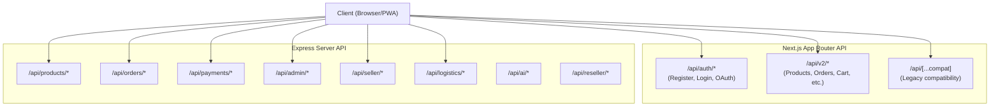

# API Reference

## Executive Summary

LofiMart exposes a dual-stack API combining Next.js App Router API routes (v1/v2) with a comprehensive Express.js server (200+ endpoints). APIs cover authentication, products, orders, payments, logistics, admin management, seller operations, reseller network, AI features, and real-time WebSocket events.

**Base URLs:**
- **Next.js API Routes:** `/api/v2/*`, `/api/auth/*`
- **Express API Routes:** `/api/*` (catch-all)
- **WebSocket:** `ws://localhost:3001`

---

## API Architecture



---

## Authentication Endpoints

### Register

```
POST /api/auth/register
```

**Request:**
```json
{
  "name": "John Doe",
  "email": "john@example.com",
  "password": "SecurePass123!",
  "role": "customer",
  "phone": "01700000000"
}
```

**Response (201):**
```json
{
  "success": true,
  "user": {
    "id": "clx123abc",
    "name": "John Doe",
    "email": "john@example.com",
    "role": "customer"
  },
  "token": "eyJhbGciOiJIUzI1NiIs...",
  "refreshToken": "dGhpcyBpcyBhIHJlZnJl..."
}
```

### Login

```
POST /api/auth/login
```

**Request:**
```json
{
  "email": "john@example.com",
  "password": "SecurePass123!"
}
```

**Response (200):**
```json
{
  "success": true,
  "user": { "id": "...", "name": "...", "email": "...", "role": "customer" },
  "token": "eyJhbGciOiJIUzI1NiIs...",
  "refreshToken": "..."
}
```

**Security:** 5 failed attempts triggers 15-minute lockout.

### Supabase OAuth Exchange

```
POST /api/auth/supabase/exchange
```

Exchanges a Supabase access token for a local session. Creates the local user record if it doesn't exist.

### Token Refresh

```
POST /api/auth/refresh
```

**Request:** `{ "refreshToken": "..." }`  
**Response:** `{ "token": "...", "refreshToken": "..." }`

### Password Reset

```
POST /api/auth/request-reset    → Sends reset email
POST /api/auth/reset-password   → Resets with token
POST /api/auth/change-password  → Changes password (auth required)
```

### Session Management

```
GET  /api/auth/sessions         → List active sessions
POST /api/auth/logout           → Revoke current session
POST /api/auth/logout-all       → Revoke all sessions
GET  /api/auth/csrf             → Get CSRF token
```

### Verification

```
POST /api/auth/send-verification     → Send email verification
GET  /api/auth/verify-email          → Verify email with token
POST /api/auth/send-phone-verification → Send phone OTP
POST /api/auth/verify-phone          → Verify phone with OTP
```

---

## Product Endpoints

### List Products

```
GET /api/products
GET /api/v2/products
```

**Query Parameters:** `category`, `sellerId`, `search`, `minPrice`, `maxPrice`, `sort`, `page`, `limit`

**Response:**
```json
{
  "products": [
    {
      "id": "...",
      "name": "Smartphone X1 Pro",
      "slug": "smartphone-x1-pro",
      "price": 25000,
      "oldPrice": 30000,
      "stock": 50,
      "rating": 4.5,
      "reviewsCount": 12,
      "category": "Electronics",
      "seller": { "id": "...", "storeName": "TechStore" }
    }
  ],
  "total": 120,
  "page": 1,
  "totalPages": 12
}
```

### Get Product

```
GET /api/products/:id
GET /api/v2/products/:id
```

### Product Reviews

```
GET  /api/products/:id/reviews
POST /api/v2/reviews          → Create review
```

### Product Suggestions

```
GET /api/products/suggestions?q=phone
```

### Search

```
GET /api/search/products?q=phone&category=electronics
GET /api/v2/search?q=phone
GET /api/search/discovery      → Discovery/explore results
```

---

## Cart Endpoints

```
GET    /api/v2/cart           → Get cart
POST   /api/v2/cart           → Add to cart
PUT    /api/v2/cart/:id       → Update quantity
DELETE /api/v2/cart/:id       → Remove item
```

**Cart Recovery:**
```
POST /api/cart/recovery/schedule   → Schedule recovery email
POST /api/cart/recovery/cancel     → Cancel recovery
```

---

## Order Endpoints

### Create Order

```
POST /api/orders/create
POST /api/v2/orders
```

**Request:**
```json
{
  "items": [
    { "productId": "...", "qty": 2, "variantSummary": "Blue / XL" }
  ],
  "shippingAddress": {
    "name": "John Doe",
    "phone": "01700000000",
    "address": "123 Main St, Dhaka",
    "division": "Dhaka",
    "district": "Dhaka District",
    "upazila": "Gulshan"
  },
  "paymentMethod": "cod",
  "couponCode": "WELCOME10",
  "refCode": "RES123"
}
```

### List Orders

```
GET /api/orders/my-orders     → Customer's orders
GET /api/v2/orders            → Customer's orders (v2)
GET /api/seller/orders        → Seller's orders
```

### Order Details

```
GET /api/orders/:id
GET /api/v2/orders/:id
```

### Order Invoice

```
GET /api/orders/:id/invoice
GET /api/orders/:id/invoice.pdf
```

### Shipping Preview

```
GET /api/shipping/preview?orderId=...
```

---

## Payment Endpoints

### bKash Tokenized Checkout

```
POST /api/payments/bkash/initiate    → Create bKash payment
POST /api/payments/bkash/execute     → Execute after user approves
GET  /api/payments/bkash/verify/:id  → Verify payment status
POST /api/payments/bkash/callback    → bKash server callback
POST /api/payments/bkash/webhook     → bKash webhook
```

### Stripe

```
POST /api/payments/stripe/webhook    → Stripe webhook handler
```

### Generic Webhook

```
POST /api/v1/payments/webhooks/:provider
```

---

## Address Endpoints

```
GET    /api/addresses          → List addresses
POST   /api/addresses          → Create address
PUT    /api/v2/addresses/:id   → Update address
DELETE /api/v2/addresses/:id   → Delete address
```

---

## Wishlist Endpoints

```
GET    /api/wishlist           → List wishlist
POST   /api/wishlist           → Add to wishlist
DELETE /api/wishlist/:productId → Remove from wishlist
GET    /api/v2/wishlist        → List (v2)
POST   /api/v2/wishlist        → Add (v2)
DELETE /api/v2/wishlist/:id    → Remove (v2)
```

---

## Coupon Endpoints

```
POST /api/coupons/validate     → Validate coupon code
POST /api/v2/coupons/validate  → Validate (v2)
```

---

## Flash Sale Endpoints

```
GET /api/flash-sale/active     → Active flash sale campaigns
```

---

## Notification Endpoints

```
GET    /api/notifications              → List notifications
POST   /api/notifications/:id/read     → Mark as read
POST   /api/notifications/read-all     → Mark all as read
POST   /api/notifications/subscribe    → Subscribe to push
POST   /api/notifications/unsubscribe  → Unsubscribe
```

---

## User Profile Endpoints

```
GET  /api/users/profile        → Get profile
POST /api/v2/profile           → Update profile
GET  /api/user/wallet          → Wallet balance & history
GET  /api/user/points          → Points balance
GET  /api/user/engagement/overview → Engagement summary
```

---

## Seller Endpoints

```
GET    /api/seller/stats               → Dashboard stats
GET    /api/seller/dashboard-insights  → AI-powered insights
GET    /api/seller/products            → List seller products
POST   /api/seller/products            → Create product
PUT    /api/seller/products/:id        → Update product
GET    /api/seller/orders              → Seller orders
GET    /api/seller/coupons             → List coupons
POST   /api/seller/coupons             → Create coupon
GET    /api/seller/inventory-alerts    → Low stock alerts
GET    /api/seller/earnings            → Earnings summary
GET    /api/seller/payouts             → Payout history
POST   /api/seller/manual-orders       → Create manual order
GET    /api/seller/manual-orders/catalog → Product catalog for manual orders
GET    /api/seller/onboarding-status   → Onboarding progress
GET    /api/seller/flash-sale          → Flash sale participation
POST   /api/seller/flash-sale/entries  → Submit flash sale entry
GET    /api/seller/pickup-locations    → Warehouse/pickup locations
GET    /api/seller/telegram/status     → Telegram bot connection
POST   /api/seller/telegram/test       → Test Telegram notification
```

---

## Admin Endpoints

### Dashboard & Analytics

```
GET /api/admin/stats                   → Platform statistics
GET /api/admin/dashboard-insights      → Dashboard intelligence
GET /api/admin/operations-summary      → Operations overview
GET /api/admin/performance/web-vitals  → Web vitals monitoring
POST /api/admin/performance/alerts/:id/ack → Acknowledge alert
```

### User Management

```
GET    /api/admin/users                → List users
POST   /api/admin/users/:id/role       → Change user role
DELETE /api/admin/users/:id            → Delete user
POST   /api/admin/users/:id/seller-status → Update seller status
GET    /api/admin/users/:id/login-activity → Login history
POST   /api/admin/users/:id/block      → Block user
POST   /api/admin/users/:id/unblock    → Unblock user
```

### Order Management

```
GET  /api/admin/orders                 → List all orders
GET  /api/admin/returns                → Return requests
POST /api/admin/returns/:id/approve    → Approve return
POST /api/admin/returns/:id/reject     → Reject return
POST /api/admin/returns/:id/refund     → Process refund
```

### Content Management

```
GET/POST/PUT/DELETE /api/admin/banners/:id?  → Banner CRUD
GET/POST /api/admin/content/about     → About page content
GET/POST/PUT/DELETE /api/admin/blog   → Blog management
```

### Category Management

```
GET/POST/PUT/DELETE /api/categories/tree   → Category tree CRUD
```

### Seller Management

```
GET /api/admin/sellers                  → List sellers
GET /api/admin/verification             → Verification queue
POST /api/admin/verification/:id/review → Review verification
```

### Financial

```
GET /api/admin/accounting/ledger-accounts  → Chart of accounts
POST /api/admin/accounting/journal-entries → Post journal entries
GET /api/admin/accounting/trial-balance    → Trial balance
GET /api/admin/accounting/profit-loss      → P&L statement
GET /api/admin/accounting/cash-summary     → Cash summary
GET /api/admin/payments/summary            → Payment summary
GET /api/admin/payments/refunds            → Refund list
GET /api/admin/payouts                     → Payout management
```

### Inventory & Logistics

```
GET  /api/admin/logistics/diagnostics      → Courier health check
GET  /api/admin/inventory/warehouses       → List warehouses
POST /api/admin/inventory/warehouses       → Create warehouse
GET  /api/admin/inventory/items            → Inventory items
GET  /api/admin/integrations/status        → Integration health
```

### POS (Point of Sale)

```
GET  /api/admin/pos/dashboard              → POS dashboard
POST /api/admin/pos/checkout               → POS checkout
GET  /api/admin/pos/inventory              → POS inventory
```

### Gamification

```
GET  /api/admin/settings                   → Tenant settings
PUT  /api/admin/settings                   → Update settings
GET  /api/admin/gamification/rewards       → Spin rewards
POST /api/admin/gamification/rewards       → Create reward
POST /api/admin/gamification/wallet-adjust → Adjust user wallet
```

---

## Reseller Endpoints

```
GET  /api/reseller/storefront-settings     → Storefront config
POST /api/reseller/storefront-settings     → Update storefront
GET  /api/reseller/catalog                 → Reseller product catalog
POST /api/reseller/markups                 → Set product markup
GET  /api/reseller/referral-link           → Get referral link
GET  /api/reseller/onboarding-status       → Onboarding progress
POST /api/reseller/manual-orders           → Create manual order
GET  /api/reseller/commissions             → Commission history
GET  /api/reseller/earnings                → Earnings summary
GET  /api/reseller/stats                   → Dashboard stats
GET  /api/reseller/network                 → Network overview
POST /api/reseller/payout-request          → Request payout
```

---

## AI Endpoints

```
POST /api/ai/chatbot                 → AI chatbot (Gemini-powered)
GET  /api/ai/recommendations         → Product recommendations
GET  /api/ai/visual-search           → Image-based search
GET  /api/ai/pricing/suggestions     → Pricing optimization
POST /api/ai/pricing/apply           → Apply price suggestion
GET  /api/ai/pricing/competitors     → Competitor prices
GET  /api/ai/pricing/demand          → Demand forecast
```

---

## Logistics Endpoints

```
GET  /api/logistics/providers                 → Registered courier providers with capabilities
                                                 (Pathao is the only one today)

GET  /api/logistics/locations?provider=&level=&parentId=
                                               → Generic location tree
                                                 level: city | zone | area

GET  /api/logistics/stores?provider=[&warehouseId=]
                                               → Pickup points for a provider
POST /api/logistics/stores                    → Register a pickup point
                                                 { provider, warehouseId, cityId,
                                                   zoneId, areaId }

POST /api/logistics/shipments/[shipmentId]/sync
                                               → Re-read one shipment from its provider
POST /api/logistics/webhooks/[provider]       → Provider webhook (dispatches to the provider adapter)

POST /api/seller/courier/bookings             → Book a shipment (seller)
                                                 { shipmentId } | { orderId } + { provider }
GET  /api/seller/logistics/courier-readiness  → Which couriers a seller can book, and why not

GET  /api/admin/logistics/diagnostics[?probe=1] → Courier health, sync backlog, unmapped locations
```

Every `/api/logistics/*` route takes `?provider=`. The provider is resolved
through the registry, and an unregistered provider returns `404`. There are
deliberately no provider-specific route variants: a new courier is added by
registering an adapter, not by adding routes.

`?probe=1` on the admin diagnostics route performs live upstream health checks.
Without it the route only reports stored state, so viewing the page does not
consume provider API quota.

Single-order booking is not exposed as a public courier route on purpose.
`POST /api/seller/courier/bookings` is the only supported way to create a
parcel, because it claims the shipment row, persists the tracking id, and is
idempotent. Calling a provider's create-order endpoint directly would create a
real consignment the database never records. `merchantReference` is derived from
the shipment id by the booking service, so retries reuse the same reference
instead of creating duplicate consignments.

Delivery prices are never returned by these routes. Quotes come from
`POST /api/shipping/preview` and are recomputed server-side at order creation;
a client-supplied fee is untrusted.

The webhook route is provider-agnostic: it resolves the provider through the
registry and delegates verification and parsing to that provider's adapter.
Pathao authenticates with `PATHAO_WEBHOOK_TOKEN`, which has no fallback, so it
fails closed when the token is unset. An unregistered provider returns `404`.

`PATHAO_BASE_URL` must be one of the two documented Pathao hosts
(`https://api-hermes.pathao.com`, `https://courier-api-sandbox.pathao.com`) over
`https`. Anything else is refused before the request is sent, because every
request carries a bearer token or the client secret. `PATHAO_ALLOW_CUSTOM_BASE_URL=1`
is an explicit opt-out for self-hosted gateways, and startup validation reports it
as an error in production.
```

---

## Public Endpoints

```
GET /api/config/public                 → Public commerce config
GET /api/public/about-page             → About page content
GET /api/public/commerce-config        → Commerce channel settings
GET /api/home                          → Homepage data
GET /api/shop-page                     → Shop page data
GET /api/categories/tree               → Category tree
```

---

## Telegram Bot API

```
POST /api/telegram/webhook             → Telegram webhook handler
GET  /api/telegram/invoices/:orderId   → Generate invoice PDF
```

---

## WebSocket Events

**Connection:** `ws://localhost:3001`

| Event | Direction | Payload | Purpose |
|-------|-----------|---------|---------|
| `stock:update` | Server→Client | `{ productId, stock }` | Real-time stock updates |
| `order:status` | Server→Client | `{ orderId, status }` | Order status changes |

---

## Media Upload

```
POST /api/media/upload          → Upload to Cloudinary
GET  /api/media/signature       → Get signed upload params
```

---

## Health Check

```
GET /api/health
```

**Response:**
```json
{
  "status": "healthy",
  "database": { "ok": true, "latencyMs": 12 },
  "redis": { "ok": true, "latencyMs": 3 },
  "uptime": 86400
}
```

---

## Compatibility Layer

```
/api/[...compat]  → Redirects legacy routes to new API structure
```

---

## Versioning Strategy

| Version | Status | Base Path |
|---------|--------|-----------|
| v1 | Legacy | `/api/*` (Express catch-all) |
| v2 | Current | `/api/v2/*` (Next.js App Router) |
| v3 | Planned | `/api/v3/*` |

**Deprecation Policy:** v1 endpoints will receive maintenance fixes only. New features are built exclusively on v2.

---

## Best Practices

1. Always include `Authorization: Bearer <token>` header for authenticated endpoints
2. Use `idempotencyKey` for payment operations to prevent duplicates
3. Implement exponential backoff for retry logic
4. Handle 429 (rate limited) responses gracefully
5. Use `Content-Type: application/json` for all POST/PUT requests

## Known Limitations

1. No GraphQL support — REST only
2. No API versioning headers — version embedded in URL path
3. WebSocket has no authentication — relies on IP-based trust
4. No streaming responses for large datasets
5. Rate limits are per-IP, not per-user

## Future Improvements

1. Add OpenAPI/Swagger documentation
2. Implement GraphQL with Apollo Server
3. Add WebSocket authentication via JWT
4. Implement cursor-based pagination for large datasets
5. Add API rate limit headers (`X-RateLimit-Remaining`)
