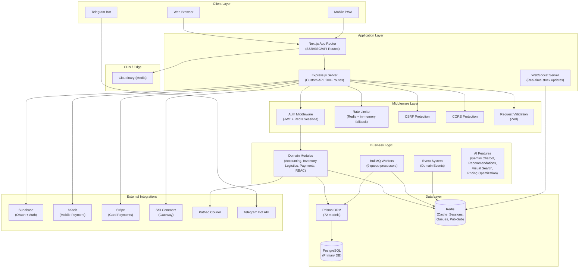
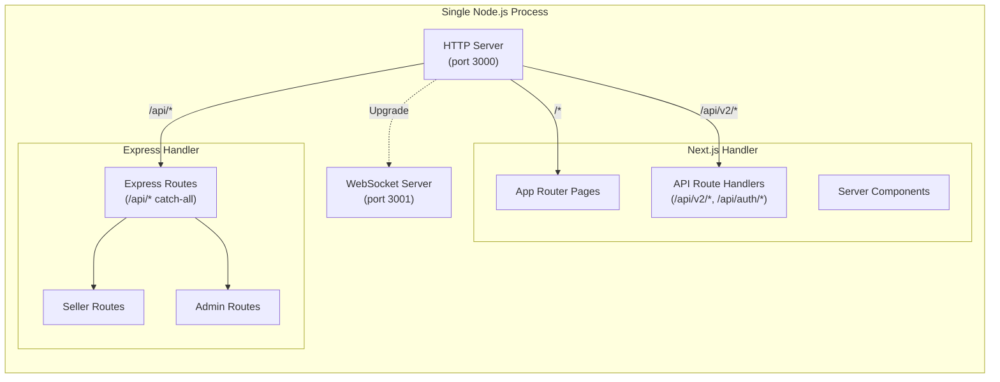
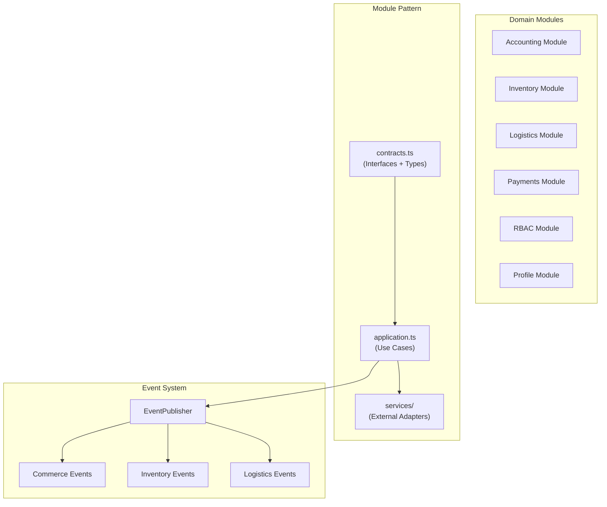
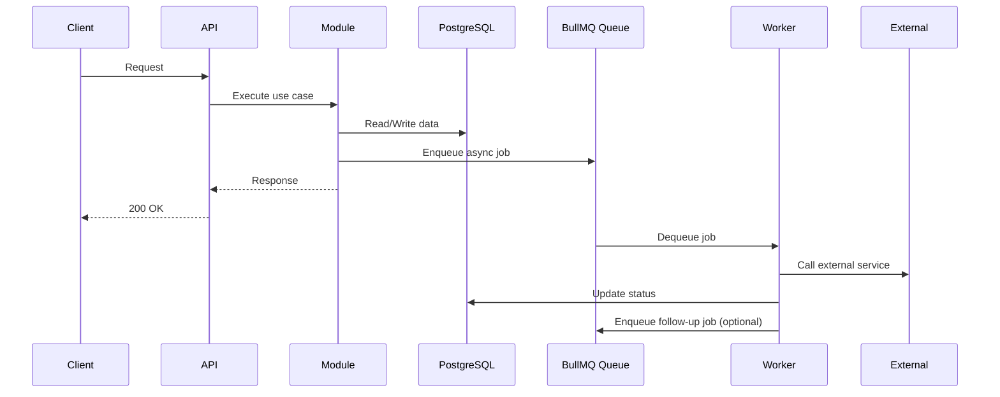
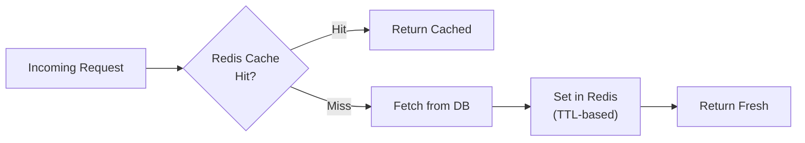
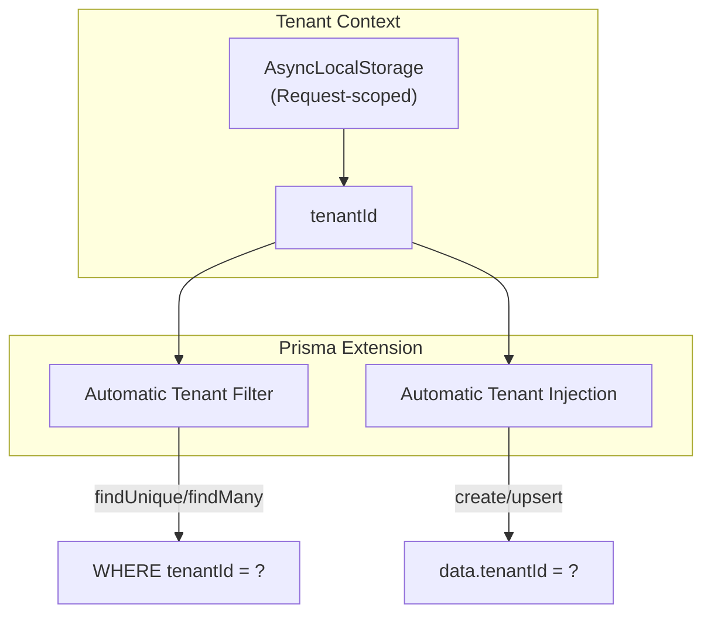
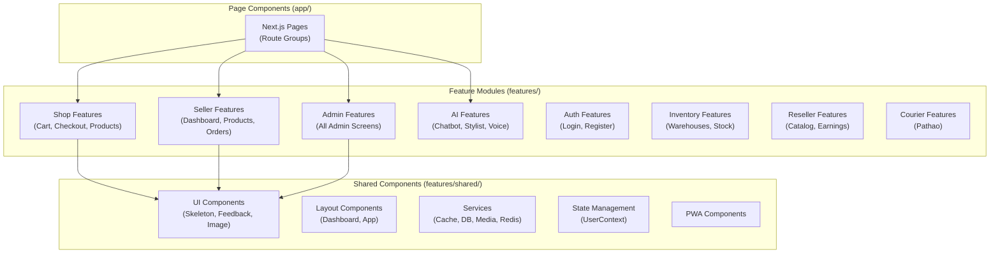
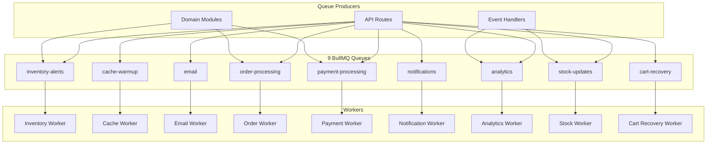
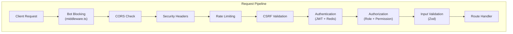

# System Architecture

## Executive Summary

LofiMart (Commerce OS) is a large-scale multi-vendor ecommerce platform built on a **dual-stack architecture** combining Next.js App Router (server-side rendering, API routes) with a custom Express.js HTTP server. The system supports customers, sellers, resellers, and administrators through role-based dashboards, integrated courier logistics, multiple payment gateways, AI-powered features, and a full accounting module.

**Key Technologies:**
- **Runtime:** Node.js (TypeScript)
- **Frontend:** Next.js 15+ (App Router, React Server Components)
- **Backend:** Express.js (custom server wrapping Next.js)
- **Database:** PostgreSQL (via Prisma ORM)
- **Cache/Pub-Sub:** Redis (ioredis)
- **Queue:** BullMQ (Redis-backed)
- **Auth:** Supabase (OAuth/email) + Custom JWT sessions
- **Realtime:** WebSocket (ws)
- **Containerization:** Docker + Docker Compose

---

## High-Level Architecture Diagram

---

## Dual-Stack Server Architecture

The application runs two server stacks in a single Node.js process:

### Request Routing Logic

1. **Next.js App Router** handles: SSR pages, `/api/v2/*` endpoints, `/api/auth/*` endpoints
2. **Express.js** handles: `/api/*` catch-all (200+ routes), seller/admin routes, logistics, payments
3. **WebSocket** handles: real-time stock updates on separate port (3001)

---

## Domain Module Architecture

The business logic is organized into domain modules following a clean architecture pattern:

Each module follows the pattern:
- **`contracts.ts`** — TypeScript interfaces, input/output types, repository contracts
- **`application.ts`** — Business logic factory functions (use cases)
- **`services/`** — External service adapters (courier APIs, payment gateways)

---

## Data Flow Architecture

### Event-Driven Processing

### Cache Strategy

**Cache Layers:**
- **Product data:** `product:{id}` with configurable TTL
- **Inventory:** `inventory:*` invalidated on stock changes
- **Commerce channel settings:** `platform:commerce-channel-settings` (5 min TTL)
- **Seller dashboard:** `seller:{id}:*` with prefix invalidation
- **bKash tokens:** `payments:bkash:tokenized:token` with skew-aware expiry

---

## Multi-Tenancy Architecture

**Tenant-scoped models:** User, Product, Order, Warehouse, Tenant, Store

The Prisma client is extended with middleware that automatically:
- Adds `tenantId` to WHERE clauses on reads
- Injects `tenantId` into data on writes
- Can be bypassed with `bypass: true` in the tenant context

---

## Frontend Architecture

### Route Groups

| Route Group | Purpose | Auth Required |
|------------|---------|---------------|
| `(shop)` | Public storefront (cart, checkout, products, search) | No |
| `(content)` | Static content (blog, about, terms, help) | No |
| `(immersive)` | AR/3D features (try-on, room visualizer) | No |
| `(bazaar)` | Marketplace discovery (affiliate, loyalty, reseller) | No |
| `(auth)` | Login, register, password reset | No |
| `(user)` | Customer dashboard (orders, wallet, wishlist) | Yes |
| `(seller)` | Seller dashboard (products, orders, analytics) | Yes |
| `(reseller)` | Reseller dashboard (catalog, earnings, network) | Yes |
| `(admin)` | Admin dashboard (all management) | Yes |

### Component Architecture

---

## Background Job Architecture

---

## Security Architecture

---

## Known Limitations

1. **Monolithic `server.ts`** — The Express server file exceeds 17,000 lines, making it difficult to maintain and test
2. **No GraphQL layer** — All data fetching is through REST, leading to potential over/under-fetching
3. **Single-process WebSocket** — WebSocket server runs in the same process; no horizontal scaling for real-time features
4. **In-memory fallback cache** — When Redis is unavailable, the system falls back to in-memory cache which doesn't persist across restarts
5. **No CDN for API responses** — Only media assets benefit from Cloudinary CDN; API responses are not edge-cached

## Future Improvements

1. **Extract Express routes** into separate modules with dependency injection
2. **Add GraphQL/Apollo** for flexible client-side data queries
3. **Externalize WebSocket** to a dedicated Redis Pub/Sub-backed service
4. **Implement API gateway** pattern for rate limiting and authentication
5. **Add OpenTelemetry** for distributed tracing across services
6. **Migrate to microservices** for payment, logistics, and AI features
7. **Add edge functions** for geo-distributed API caching
