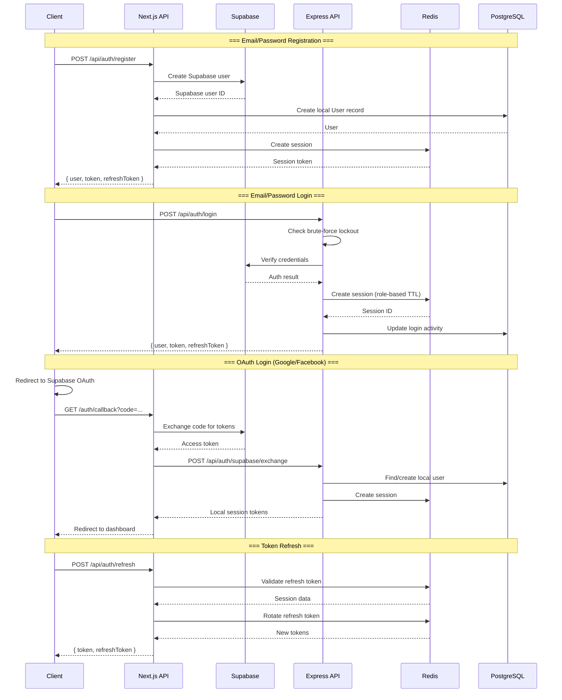
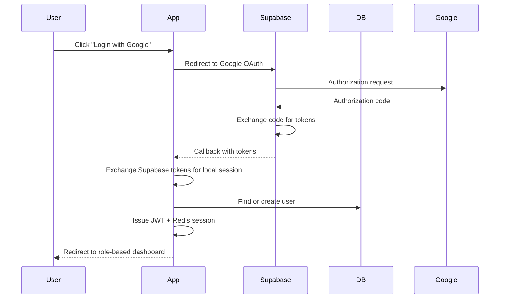
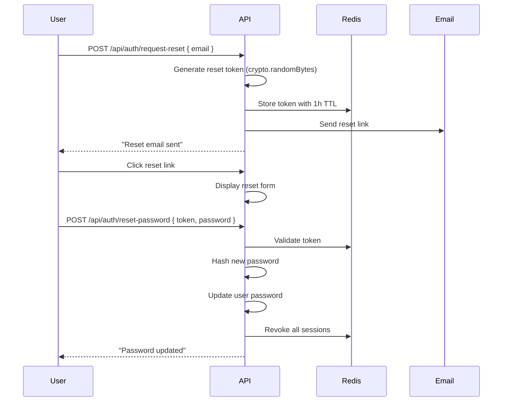
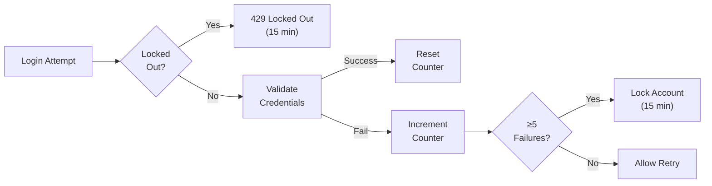
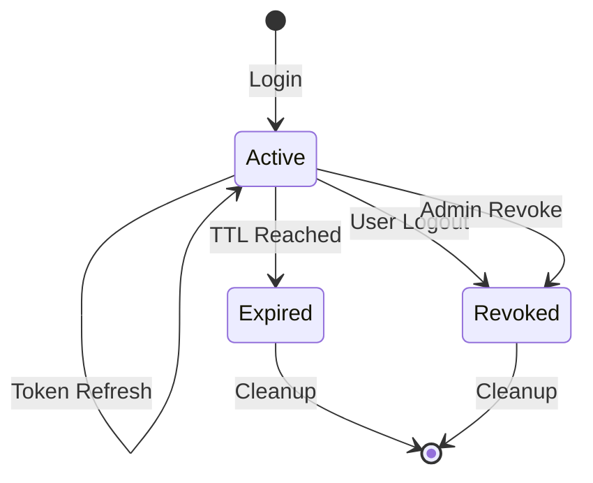
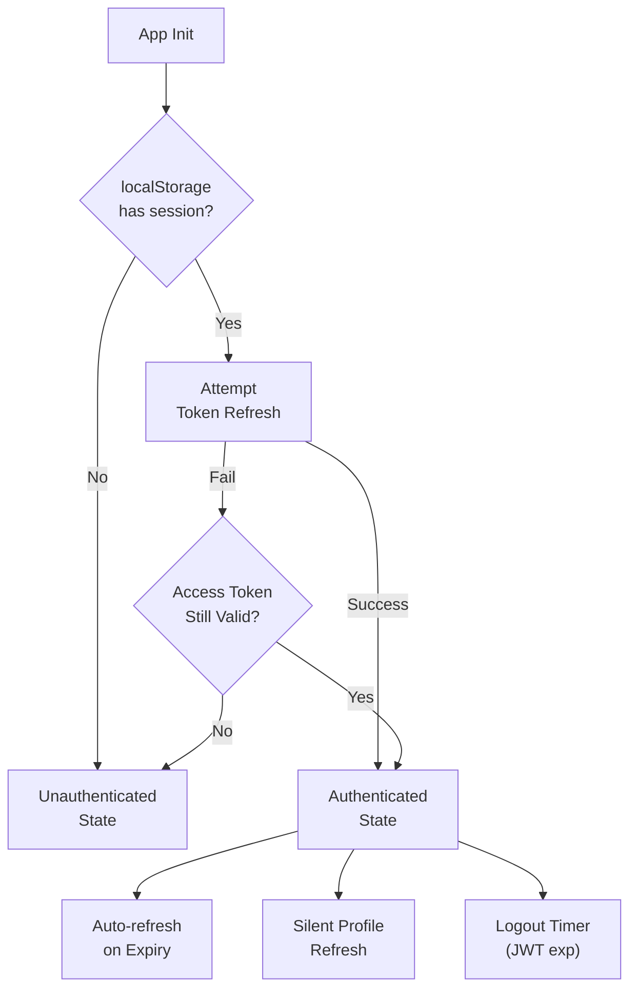

# Authentication System

## Executive Summary

LofiMart uses a hybrid authentication system combining **Supabase** (OAuth/email identity provider) with custom **JWT + Redis** session management. The system supports email/password login, Google/Facebook OAuth, phone verification, and role-based session management with different TTLs per role.

---

## Authentication Flow



---

## Session Architecture

### Token Types

| Token | Storage | TTL | Purpose |
|-------|---------|-----|---------|
| Access Token (JWT) | Cookie + localStorage | Role-based | API authentication |
| Refresh Token | Redis + Cookie | Sliding | Token rotation |
| CSRF Token | Cookie + Header | Per-request | State change protection |

### Role-Based Session TTLs

| Role | Access Token TTL | Refresh Token TTL |
|------|-----------------|-------------------|
| Customer | 24 hours | 7 days |
| Seller | 1 hour | 7 days |
| Reseller | 1 hour | 7 days |
| Admin | 1 hour | 7 days |

### Session Data Model

```typescript
interface SessionUser {
  id: string;
  email?: string;
  name?: string;
  role: 'customer' | 'seller' | 'reseller' | 'admin';
  tenantId?: string;
}
```

**Redis Session Key Pattern:**
- Session: `session:{refreshTokenHash}` → `{ user, accessToken, deviceInfo, expiresAt }`
- User Sessions Set: `user-sessions:{userId}` → Set of active refresh token hashes

---

## OAuth Integration

### Supported Providers

| Provider | Scope | Notes |
|----------|-------|-------|
| Google | email, profile | Via Supabase |
| Facebook | email, profile | Via Supabase |

### OAuth Flow



### Pending OAuth State

The `AuthPages.tsx` component stores pending OAuth redirect state in `sessionStorage` to handle the redirect flow:
1. User clicks OAuth button
2. Pending redirect target saved to `sessionStorage`
3. OAuth flow completes via `/auth/callback`
4. Exchange happens for local session
5. User redirected to saved target

---

## Password Security

### Hashing
- **Algorithm:** bcrypt via Supabase Auth
- **Salt rounds:** 12

### Password Reset Flow



---

## Brute-Force Protection



**Implementation Details:**
- Counter key: `auth:lockout:{email}`
- Lockout duration: 15 minutes
- Threshold: 5 failed attempts
- Redis-backed with in-memory fallback

---

## Multi-Device Session Management

### Features
- **Device tracking:** Name, IP address, user agent, geolocation
- **Concurrent sessions:** Multiple devices supported
- **Session listing:** Users can view all active sessions
- **Per-device logout:** Revoke individual sessions
- **Global logout:** Revoke all sessions for a user

### Session Lifecycle



---

## Phone Verification

```
POST /api/auth/send-phone-verification → Sends OTP
POST /api/auth/verify-phone           → Verifies OTP
```

OTP stored in `PhoneVerificationToken` with expiry.

---

## Client-Side Auth State

**Implementation:** `UserContext.tsx`



**State Persistence:**
- `localStorage`: user, token, refreshToken
- Automatic logout on token expiry
- Silent refresh on app load
- Profile data refreshed silently after login

---

## Supabase Integration

### Client Setup

```typescript
// Browser client
const supabase = createSupabaseBrowserClient();

// Server client
const supabase = createSupabaseServerClient();
```

### Token Exchange Flow

1. Supabase provides OAuth/email tokens
2. Local system exchanges for custom JWT
3. Local user record created/linked
4. Session stored in Redis

---

## Best Practices

1. **Use httpOnly cookies** for refresh tokens — Prevents XSS access
2. **Rotate refresh tokens** on every use — Limits token reuse window
3. **Validate JWT signature AND Redis session** — Double verification
4. **Apply role-based TTLs** — Admin sessions expire faster
5. **Log all auth events** — Enable forensic analysis
6. **Revoke sessions on password change** — Prevent stale access
7. **Use timing-safe comparison** for all token validations
8. **Store tokens in memory only** when possible — Reduce localStorage exposure

## Known Limitations

1. No hardware key (FIDO2/WebAuthn) support
2. No TOTP/2FA integration (field exists but not enforced)
3. OAuth tokens stored in sessionStorage — Vulnerable to XSS
4. No IP-based session binding
5. No anomalous login detection

## Future Improvements

1. Implement TOTP-based 2FA for seller/admin accounts
2. Add FIDO2/WebAuthn support
3. Add IP-based session binding for high-privilege roles
4. Implement login anomaly detection (new device, new location)
5. Add session idle timeout in addition to absolute TTL
