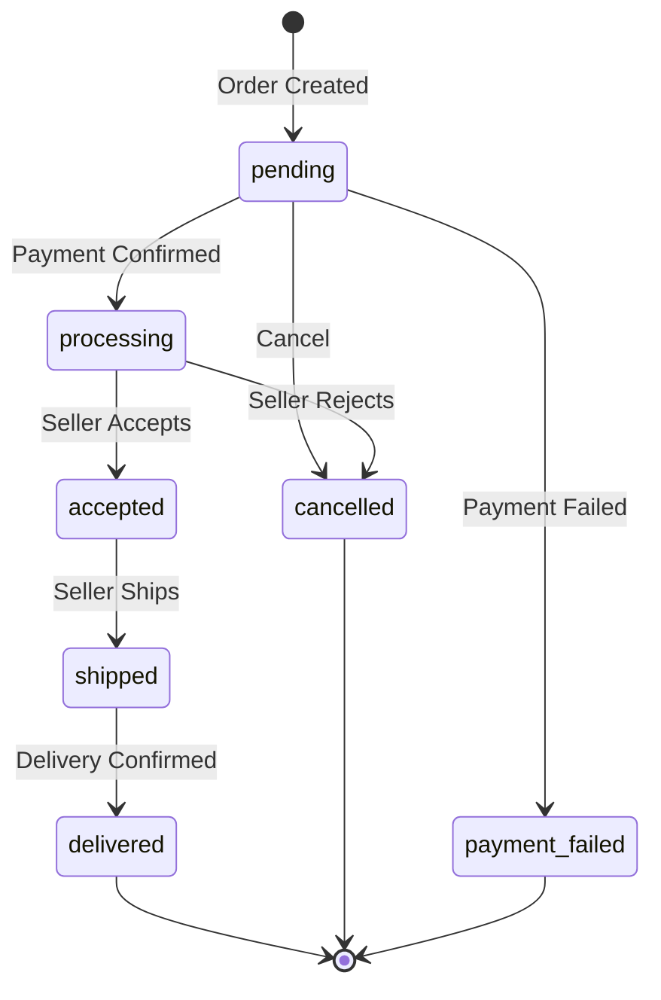

# Business Rules

## Executive Summary

LofiMart enforces comprehensive business rules across product management, order processing, payment handling, seller operations, inventory control, and commission calculations.

---

## Product Rules

| Rule | Description |
|------|-------------|
| Price >= 0 | Product price must be non-negative |
| Unique SKU | SKU field is globally unique |
| Unique slug | Product slugs are globally unique |
| Stock >= 0 | Negative stock not permitted |
| Category required | Products must belong to a category |
| Atomic stock decrement | Uses Prisma atomic decrement with gte condition |
| Price history tracked | Every price change logged |
| Low stock alerts | Telegram notifications when stock <= threshold |

---

## Order Rules

| Rule | Description |
|------|-------------|
| Minimum 1 item | Orders must contain at least one item |
| Stock validation | Each item stock checked before order creation |
| Price lock | Order item price locked at time of purchase |
| Multi-seller splitting | Orders automatically split into per-seller shipments |
| Order code format | ORD-{timestamp}-{random6chars} |

### Order Status State Machine

---

## Payment Rules

| Method | Processing |
|--------|-----------|
| COD | No online payment; collected on delivery |
| bKash | Server-side verification required; browser callback never trusted |
| Stripe | PaymentIntent flow with webhook confirmation |
| SSLCommerz | Redirect flow with callback verification |
| Wallet | Atomic wallet debit with balance check |

### Refund Rules
- Admin approval required for all refunds
- Wallet credit option available
- Stock restoration on refund
- Full audit trail maintained

---

## Seller Rules

| Rule | Description |
|------|-------------|
| Onboarding required | Must complete setup before selling |
| Admin review | All seller applications reviewed |
| Commission deducted | Platform commission on each sale |
| Payout encryption | Account numbers encrypted with AES-256-GCM |
| Vacation mode | Temporary store pause capability |

---

## Inventory Rules

| Rule | Description |
|------|-------------|
| Multi-warehouse | Products tracked per warehouse |
| Atomic operations | Stock changes use database-level atomicity |
| Movement tracking | Every change recorded in InventoryMovement |
| Reserved stock | Cart reservations counted separately |
| Reorder alerts | Configurable per-warehouse threshold |

---

## Coupon Rules

| Rule | Description |
|------|-------------|
| Unique codes | Coupon codes globally unique |
| Discount types | Percentage or fixed amount |
| Minimum order value | Coupon only applies above threshold |
| Expiry date | Coupons expire after configured date |
| Seller-scoped | Each coupon tied to a specific seller |

---

## Flash Sale Rules

| Rule | Description |
|------|-------------|
| Campaign-based | Organized as campaigns with time bounds |
| Admin review | All seller submissions require approval |
| Allocated stock | Sellers allocate specific stock |
| Unique per product | Each product appears once per campaign |

---

## Gamification Rules

| Rule | Description |
|------|-------------|
| Daily login streak | Consecutive days, configurable rewards |
| Spin wheel | Daily limit, probability-weighted rewards |
| Missions | Target-based with progress tracking |
| Referrals | Unique codes, inviter and invitee rewards |

---

## Address Rules

| Rule | Description |
|------|-------------|
| Bangladesh-specific | Division, District, Upazila hierarchy |
| Default address | One default per user |
| Phone validation | 11-digit Bangladeshi mobile format |

---

## Best Practices

1. Validate all inputs with Zod schemas at API boundary
2. Use transactions for multi-step business operations
3. Atomic stock operations never read-then-write
4. Idempotency keys for payment operations
5. Audit trail for all state-changing operations
6. Fail safe: default to safe state on errors

## Known Limitations

1. No partial payments
2. No split payments across methods
3. No automatic restocking
4. No dynamic pricing (AI suggestions optional only)
5. No cross-warehouse stock allocation

## Future Improvements

1. Partial payment support
2. Split payment across methods
3. Automatic reorder triggers
4. Dynamic pricing engine
5. Cross-warehouse stock allocation

---
