# Database Architecture

## Executive Summary

LofiMart uses **PostgreSQL** as the primary database, accessed through **Prisma ORM** with 72 data models spanning ecommerce, multi-vendor marketplace, inventory management, payments, logistics, accounting, gamification, community, AI/ML analytics, and reseller network functionality.

**Key Statistics:**
- **72 Prisma Models** across 15+ business domains
- **Schemas:** `public` (application), `auth` (Supabase)
- **Connection:** `DATABASE_URL` (pooled) + `DIRECT_URL` (migrations)
- **Multi-tenancy:** Automatic tenant filtering via Prisma extension + AsyncLocalStorage

---

## Entity Relationship Diagram

```mermaid
erDiagram
    User ||--o{ Order : places
    User ||--o{ Product : sells
    User ||--o{ Review : writes
    User ||--o{ WishlistItem : has
    User ||--o{ Address : has
    User ||--o{ Session : has
    User ||--o{ LoginActivity : has
    User ||--o{ AuditLog : generates
    User ||--o{ Coupon : creates
    User ||--o{ BlogPost : authors
    User ||--o{ CommunityPost : creates
    User ||--o{ WalletTransaction : earns
    User ||--o{ RewardLog : receives
    User ||--o{ ReferralCode : owns
    User ||--o{ NotificationPreference : configures
    User ||--o{ UserNotification : receives
    User ||--o{ PayoutMethod : registers
    User ||--o{ PayoutTransaction : receives
    User ||--o{ VerificationSubmission : submits
    User ||--o{ PushSubscription : registers
    User ||--o{ UserRiskFlag : flagged_by

    Product ||--o{ OrderItem : included_in
    Product ||--o{ Review : has
    Product ||--o{ WishlistItem : wishlisted
    Product ||--o{ InventoryItem : tracked_in
    Product ||--o{ InventoryMovement : moves
    Product ||--o{ StockReservation : reserved_in
    Product ||--o{ FlashSaleEntry : featured_in
    Product ||--o{ PurchaseOrderLine : ordered_in
    Product ||--o{ PriceHistory : priced_at
    Product ||--o{ PricingSuggestion : suggested_for
    Product ||--o{ UserInteraction : interacted_with
    Product ||--o{ RecommendationAnalytic : recommended_in
    Product ||--o{ ResellerMarkup : marked_up_by

    Order ||--o{ OrderItem : contains
    Order ||--o{ OrderShipment : ships_as
    Order ||--o{ PaymentTransaction : paid_via
    Order ||--o{ Invoice : invoiced
    Order ||--o{ Refund : refunded

    OrderShipment ||--o{ OrderShipmentItem : contains
    OrderShipment }o--|| User : seller
    OrderShipment }o--o| Warehouse : from

    Warehouse ||--o{ InventoryItem : holds
    Warehouse ||--o{ PurchaseOrder : receives
    Warehouse ||--o{ StockReservation : reserves

    Tenant ||--o{ User : contains
    Tenant ||--o{ Product : contains
    Tenant ||--o{ Order : contains
    Tenant ||--o{ Store : has
    Tenant ||--o{ TenantSetting : configures
    Tenant ||--o{ TenantMembership : members
    Tenant ||--o{ WalletTransaction : tracks
    Tenant ||--o{ RewardLog : tracks
    Tenant ||--o{ SpinReward : offers
    Tenant ||--o{ Mission : defines
    Tenant ||--o{ CommunityPost : hosts
    Tenant ||--o{ UserNotification : sends

    Tenant ||--o{ FlashSaleCampaign : runs
    FlashSaleCampaign ||--o{ FlashSaleEntry : includes

    Category ||--o{ Subcategory : has
    Subcategory ||--o{ Subsubcategory : has

    CommunityPost ||--o{ CommunityPostComment : has
    CommunityPost ||--o{ CommunityPostLike : receives
    CommunityPost ||--o{ CommunityPostReport : reported

    LedgerAccount ||--o{ JournalLine : records
    JournalEntry ||--o{ JournalLine : contains

    ReferralCode ||--o{ ReferralAttribution : tracks

    Mission ||--o{ MissionProgress : tracked_by

    SpinReward ||--o{ SpinHistory : history_of

    PayoutMethod ||--o{ PayoutTransaction : processes

    VerificationSubmission ||--o{ VerificationDocument : includes

    User ||--o{ ResellerCommission : earns
    User ||--o{ ResellerReferral : refers
    User ||--o{ ResellerPayout : paid
```



---

## Core Models

### User & Authentication

| Model | Purpose | Key Fields |
|-------|---------|------------|
| `User` | Central user entity | id, email, passwordHash, role, sellerStatus, points, walletBalance, twoFactorEnabled, phoneVerified, tenantId |
| `Session` | Active login sessions | id, userId, tokenHash (unique), deviceName, ipAddress, expiresAt |
| `LoginActivity` | Login audit trail | userId, sessionId, ipAddress, userAgent, deviceName, loggedInAt, lastSeenAt |
| `PasswordResetToken` | Password reset flow | userId, token (unique), expiresAt, used |
| `EmailVerificationToken` | Email verification | userId, token (unique), expiresAt, used |
| `PhoneVerificationToken` | Phone verification | userId, token (unique), expiresAt, used |
| `PushSubscription` | Web push subscriptions | userId, endpoint (unique), data |

### Product Catalog

| Model | Purpose | Key Fields |
|-------|---------|------------|
| `Product` | Product listings | id, sku (unique), name, slug (unique), price, oldPrice, stock, category, sellerId, rating, reviewsCount, status, resellerEnabled, resellerBasePrice |
| `Category` | Top-level categories | id, name, icon |
| `Subcategory` | Second-level | categoryId, name, icon |
| `Subsubcategory` | Third-level | subcategoryId, name |
| `Review` | Product reviews | productId, userId, rating, comment |
| `WishlistItem` | User wishlists | userId, productId (unique pair) |
| `PriceHistory` | Price tracking | productId, price, competitorPrices, demandScore, conversionRate |
| `PricingSuggestion` | AI pricing | productId, suggestedPrice, confidenceScore, reasons, applied |

### Orders & Fulfillment

| Model | Purpose | Key Fields |
|-------|---------|------------|
| `Order` | Customer orders | id, orderCode (unique), userId, total, status, paymentStatus, paymentMethod, shippingAddress (Json), refCode |
| `OrderItem` | Line items | orderId, productId, qty, price, variantSummary |
| `OrderShipment` | Per-seller shipments | orderId, sellerId, warehouseId, status, total, courier fields, tracking fields |
| `OrderShipmentItem` | Shipment line items | shipmentId, orderItemId, productId, qty, price |
| `Invoice` | Order invoices | orderId (unique), userId, status, subtotal, tax, total |
| `AccountActionRequest` | Cancellation/refund requests | userId, orderId, type, status, reason |

### Inventory Management

| Model | Purpose | Key Fields |
|-------|---------|------------|
| `Warehouse` | Storage locations | id, name, tenantId, address, city, Pathao integration fields, shipping fee overrides |
| `InventoryItem` | Stock per warehouse | productId, warehouseId (unique pair), quantity, reserved, reorderLevel |
| `InventoryMovement` | Stock change audit | inventoryItemId, productId, warehouseId, type, quantityDelta, reason, reference |
| `StockReservation` | Cart reservations | productId, warehouseId, orderId, quantity, status, expiresAt |
| `PurchaseOrder` | Supplier orders | warehouseId, supplierName, status, currency |
| `PurchaseOrderLine` | PO line items | purchaseOrderId, productId, quantity, unitCost |

### Payments

| Model | Purpose | Key Fields |
|-------|---------|------------|
| `PaymentTransaction` | Payment records | provider, paymentId (unique), orderId, amount, currency, status, idempotencyKey (unique), metadata |
| `Refund` | Refund records | transactionId, providerRefundId (unique), amount, reason, status |
| `PayoutMethod` | Seller payout accounts | userId, type, provider, encryptedAccountNumber, isDefault |
| `PayoutTransaction` | Payout history | userId, payoutMethodId, amount, status, processedAt |

### Multi-Tenancy

| Model | Purpose | Key Fields |
|-------|---------|------------|
| `Tenant` | Tenant organizations | id, slug (unique), name |
| `Store` | Tenant storefronts | tenantId, name, domain (unique), currency, locale |
| `TenantMembership` | User-tenant roles | userId, tenantId (unique pair), role, isPrimary |
| `TenantSetting` | Tenant configuration | tenantId (unique), currency, locale, freeShippingThreshold, gamification settings |

### Gamification & Rewards

| Model | Purpose | Key Fields |
|-------|---------|------------|
| `WalletTransaction` | Wallet credits/debits | userId, type, amount, currency, status, source, balanceAfter |
| `RewardLog` | Reward event audit | userId, eventType, coinsAmount, walletAmount, source |
| `ReferralCode` | Referral tracking | userId, code (unique), clicks, successfulReferrals, earnings |
| `ReferralAttribution` | Referral attribution | codeId, inviterId, inviteeId, orderId, status |
| `LoginStreak` | Daily login tracking | userId (unique), currentStreak, longestStreak, lastClaimedOn |
| `SpinReward` | Spin wheel prizes | tenantId, label, rewardType, rewardValue, probability |
| `SpinHistory` | Spin history | userId, rewardId, dateKey (unique pair) |
| `Mission` | Achievement missions | key (unique), title, targetCount, rewardCoins |
| `MissionProgress` | Mission tracking | userId, missionId (unique pair), progress, completedAt |

### Community & Content

| Model | Purpose | Key Fields |
|-------|---------|------------|
| `CommunityPost` | User posts | userId, title, content, topic, status, likesCount, commentsCount, moderation fields |
| `CommunityPostComment` | Comments | postId, userId, content, status |
| `CommunityPostLike` | Likes | postId, userId (unique pair) |
| `CommunityPostReport` | Content reports | postId, userId, reason, status |
| `BlogPost` | Blog articles | title, slug (unique), content, authorId, SEO fields |
| `Banner` | Homepage banners | title, image, link, isActive |
| `ContactMessage` | Contact form | name, email, subject, message, status |

### Flash Sales

| Model | Purpose | Key Fields |
|-------|---------|------------|
| `FlashSaleCampaign` | Campaign definitions | title, slug (unique), startsAt, endsAt, status |
| `FlashSaleEntry` | Seller submissions | campaignId, sellerId, productId (unique pair), salePrice, allocatedStock, status |

### Reseller Network

| Model | Purpose | Key Fields |
|-------|---------|------------|
| `ResellerMarkup` | Per-product pricing | resellerId, productId (unique pair), markupAmount |
| `ResellerCommission` | Earnings tracking | resellerId, orderId, productId, amount, status |
| `ResellerReferral` | Referral links | resellerId (unique), code (unique), clicks |
| `ResellerPayout` | Payout requests | resellerId, amount, status, paidAt |

### Accounting

| Model | Purpose | Key Fields |
|-------|---------|------------|
| `LedgerAccount` | Chart of accounts | code (unique), name, type (asset/liability/equity/revenue/expense) |
| `JournalEntry` | Double-entry records | reference (unique), memo, currency |
| `JournalLine` | Debit/credit lines | journalEntryId, accountId, debit, credit |
| `Expense` | Business expenses | category, amount, vendor, notes, incurredAt |

### AI/ML Analytics

| Model | Purpose | Key Fields |
|-------|---------|------------|
| `UserInteraction` | Behavior tracking | userId, productId, interactionType, sessionId, deviceType |
| `RecommendationAnalytic` | Recommendation tracking | recommendationId, userId, productId, position, clicked, converted |

### Security & Moderation

| Model | Purpose | Key Fields |
|-------|---------|------------|
| `AuditLog` | Activity audit trail | userId, action, entityType, entityId, metadata |
| `VerificationSubmission` | Seller verification | userId, role, status, documentType, businessName, riskScore |
| `VerificationDocument` | Verification files | verificationId, type, label, url |
| `UserRiskFlag` | Risk assessment | userId, severity, reason, isActive |

---

## Multi-Tenancy Implementation

### Tenant Context (AsyncLocalStorage)

```typescript
// src/features/shared/services/database/tenantContext.ts
import { AsyncLocalStorage } from 'node:async_hooks';

type TenantContextValue = {
  tenantId?: string | null;
  bypass?: boolean;
};

const tenantStorage = new AsyncLocalStorage<TenantContextValue>();

export function withTenantContext<T>(context: TenantContextValue, fn: () => Promise<T>) {
  return tenantStorage.run(context, fn);
}

export function getTenantContext() {
  return tenantStorage.getStore() ?? {};
}
```

### Prisma Tenant Extension

The Prisma client automatically:
1. **Reads:** Adds `WHERE tenantId = ?` to all find operations on scoped models
2. **Writes:** Injects `tenantId` into all create/upsert operations
3. **Scoped Models:** User, Product, Order, Warehouse, Tenant, Store

```typescript
// Simplified from src/features/shared/services/database/prisma.ts
const tenantScopedModels = new Set(['User', 'Product', 'Order', 'Warehouse', 'Tenant', 'Store']);

const prisma = basePrisma.$extends({
  query: {
    $allModels: {
      async $allOperations({ model, operation, args, query }) {
        const context = getTenantContext();
        if (!context.tenantId || context.bypass || !tenantScopedModels.has(model)) {
          return query(args);
        }
        // Auto-filter by tenantId on reads
        // Auto-inject tenantId on writes
      }
    }
  }
});
```

---

## Key Indexes

| Table | Index | Purpose |
|-------|-------|---------|
| Product | `sellerId` | Seller product lookups |
| Product | `category` | Category filtering |
| Product | `[status, publishedAt]` | Published product queries |
| Product | `rating` | Sort by rating |
| Order | `userId` | User order history |
| Order | `[status, createdAt]` | Status-based queries |
| Order | `tenantId` | Tenant order filtering |
| Order | `paymentStatus` | Payment status lookups |
| OrderItem | `orderId` | Order line item loading |
| InventoryItem | `[productId, warehouseId]` (unique) | Stock lookups |
| AuditLog | `userId` | User activity queries |
| AuditLog | `[entityType, entityId]` | Entity audit lookups |
| WishlistItem | `[userId, productId]` (unique) | Duplicate prevention |
| CommunityPostLike | `[postId, userId]` (unique) | Duplicate prevention |
| SpinHistory | `[userId, dateKey]` (unique) | Daily spin limits |
| MissionProgress | `[userId, missionId]` (unique) | Mission tracking |

---

## Seed Data

The `prisma/seed.ts` file initializes:
- **Admin user:** `admin@amarshop.local` / `ChangeMe123!`
- **Seller user:** `seller@amarshop.local` / `ChangeMe123!`
- **8 categories:** Fashion, Electronics, Groceries, Home & Living, Beauty, Baby Care, Sports, Art & Crafts
- **2 coupons:** `WELCOME10` (10% off), `SAVE500` (500 BDT flat)
- **2 products:** Smartphone X1 Pro, Wireless Headphones
- **1 banner, 1 blog post, 2 ledger accounts**

---

## Best Practices

1. **Always use the tenant-scoped Prisma client** (`prisma`) for application code; use `prismaDirect` only for cross-tenant operations
2. **Use `$transaction`** for multi-step writes (order creation, payment finalization)
3. **Prefer `findUnique` with `select`** over `findMany` with `include` for single-record lookups
4. **Use compound unique constraints** to prevent race conditions (e.g., `[userId, productId]` on WishlistItem)
5. **Index foreign keys** used in frequent JOIN/WHERE clauses
6. **Use JSON columns** for flexible data (shippingAddress, metadata) that doesn't need relational queries

## Known Limitations

1. **No read replicas** — All queries hit the primary database
2. **No connection pooling configuration** — Using Prisma's default pool settings
3. **JSON columns** for shipping addresses prevent efficient geo-queries
4. **No database-level constraints** for business rules (e.g., stock >= 0) — enforced at application level
5. **Single schema** — All tenants share the same schema with logical isolation

## Future Improvements

1. Add read replicas for scaling read-heavy operations
2. Implement row-level security (RLS) at the database level
3. Add materialized views for complex analytics queries
4. Implement proper partitioning for high-volume tables (Order, AuditLog)
5. Add database-level CHECK constraints for business rules
6. Consider Citus for horizontal scaling of tenant data
