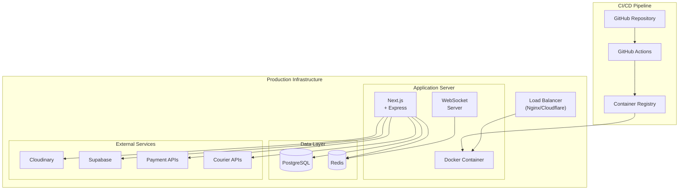
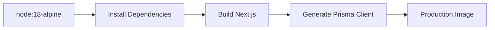
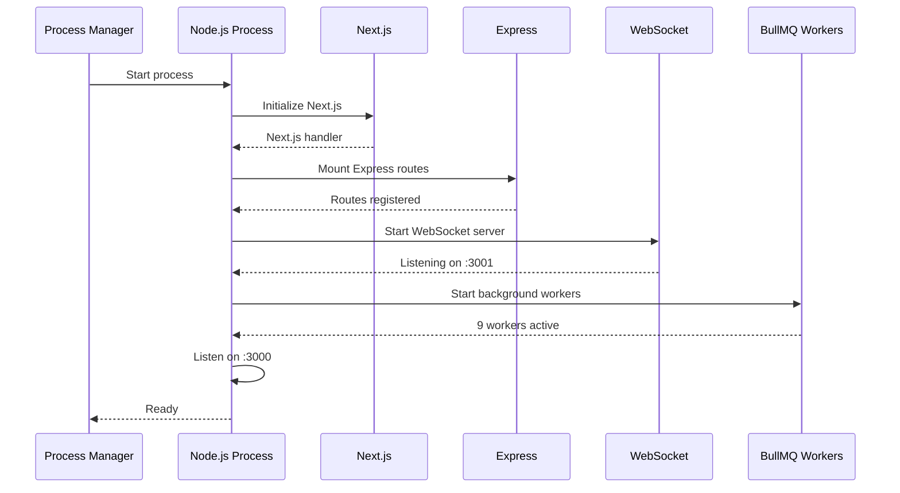
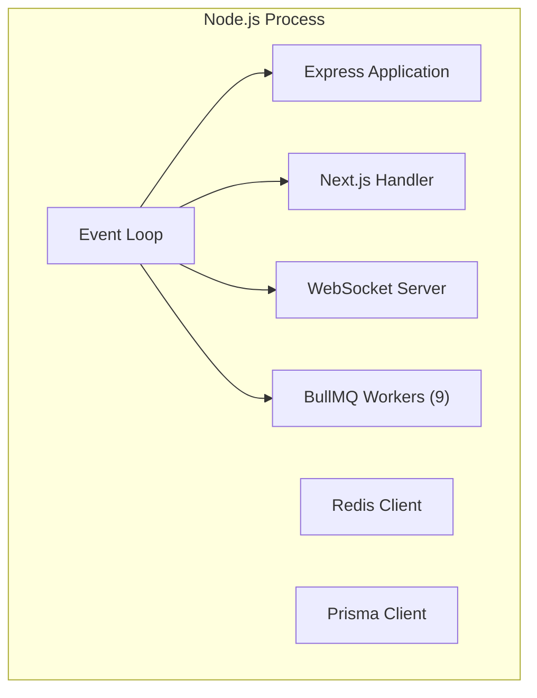
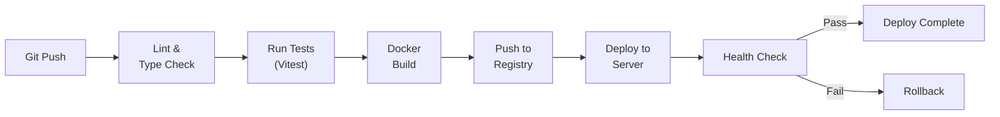
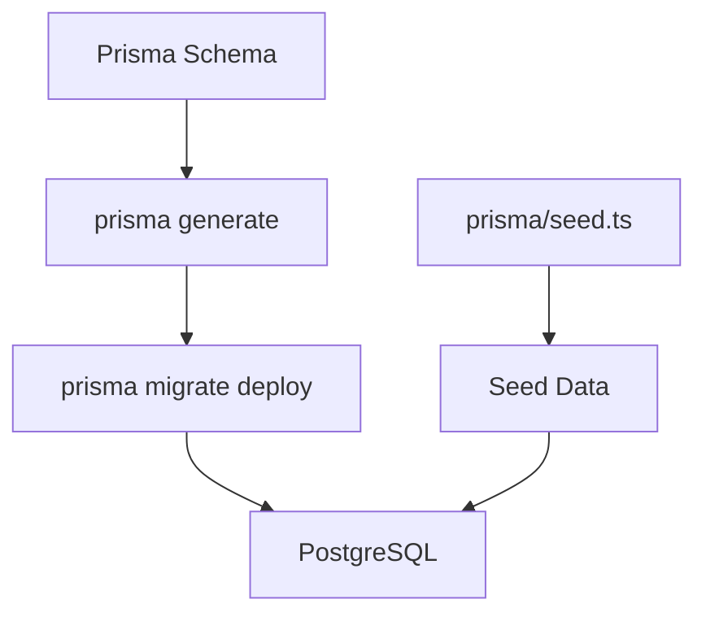
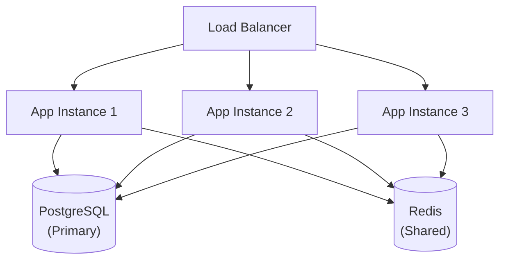

# Deployment Architecture

## Executive Summary

LofiMart is deployed as a Docker container running Next.js with a custom Express server, backed by PostgreSQL and Redis. The deployment supports both Docker Compose (single-server) and cloud-native (Kubernetes) architectures with CI/CD via GitHub Actions.

---

## Deployment Architecture



---

## Docker Configuration

### Dockerfile



**Multi-stage build:**
1. **Base:** `node:18-alpine`
2. **Dependencies:** `npm ci` with dev dependencies
3. **Build:** `npx prisma generate && npm run build`
4. **Production:** Copy built artifacts, prune dev dependencies
5. **Run:** `node server.js` (custom server)

### Docker Compose

```yaml
services:
  app:
    build: .
    ports:
      - "3000:3000"
      - "3001:3001"  # WebSocket
    environment:
      - DATABASE_URL=postgresql://...
      - REDIS_URL=redis://...
    depends_on:
      - postgres
      - redis

  postgres:
    image: postgres:16-alpine
    volumes:
      - pgdata:/var/lib/postgresql/data
    environment:
      - POSTGRES_DB=lofimart
      - POSTGRES_PASSWORD=...

  redis:
    image: redis:7-alpine
    volumes:
      - redisdata:/data
```

---

## Server Startup



---

## Process Management

### Port Allocation

| Port | Service | Protocol |
|------|---------|----------|
| 3000 | HTTP (Next.js + Express) | HTTP/HTTPS |
| 3001 | WebSocket | WS/WSS |

### Process Model



---

## CI/CD Pipeline



**GitHub Actions Workflow:**

| Step | Action |
|------|--------|
| 1 | Checkout code |
| 2 | Setup Node.js |
| 3 | Install dependencies |
| 4 | Run linting (`eslint`) |
| 5 | Run type checking (`tsc`) |
| 6 | Run tests (`vitest`) |
| 7 | Build Docker image |
| 8 | Push to container registry |
| 9 | Deploy to server |
| 10 | Health check |

---

## Database Migrations



**Migration Strategy:**
1. Schema changes in `prisma/schema.prisma`
2. Generate migrations: `prisma migrate dev`
3. Apply in production: `prisma migrate deploy`
4. Seed initial data: `prisma db seed`

---

## Environment Deployment

### Development

```bash
# Local development
npm install
npx prisma migrate dev
npx prisma db seed
npm run dev
```

### Production (Docker)

```bash
# Build and run
docker compose up -d

# Database migrations
docker compose exec app npx prisma migrate deploy

# Seed (first deploy only)
docker compose exec app npx prisma db seed
```

### Production (Cloud)

```bash
# Build
docker build -t lofimart:latest .

# Run
docker run -d \
  --name lofimart \
  -p 3000:3000 \
  -p 3001:3001 \
  --env-file .env.production \
  lofimart:latest
```

---

## Health Checks

### Application Health

```
GET /api/health
```

```json
{
  "status": "healthy",
  "database": { "ok": true, "latencyMs": 12, "provider": "postgresql" },
  "redis": { "ok": true, "latencyMs": 3, "status": "ready" },
  "uptime": 86400
}
```

### Health Check Components

| Component | Check | Timeout |
|-----------|-------|---------|
| PostgreSQL | `SELECT 1` query | 5s |
| Redis | `PING` command | 3s |
| Application | Process alive | Immediate |
| WebSocket | Port listening | 3s |

---

## Scaling Considerations

### Horizontal Scaling



### Scaling Bottlenecks

| Bottleneck | Current | Solution |
|-----------|---------|----------|
| Single process | All-in-one Node.js | Extract Express/WS to separate services |
| WebSocket | Single process | Redis Pub/Sub for multi-instance WS |
| Database | Single PostgreSQL | Read replicas, connection pooling |
| Cache | Single Redis | Redis Cluster |
| Workers | In-process | External BullMQ with Redis |

---

## Backup Strategy

| Component | Frequency | Method |
|-----------|-----------|--------|
| PostgreSQL | Daily | `pg_dump` to S3 |
| Redis | Every 6 hours | RDB snapshot to S3 |
| Media (Cloudinary) | Continuous | Cloudinary backup |
| Application config | On change | Git repository |

---

## Security Hardening

| Measure | Implementation |
|---------|---------------|
| HTTPS | Nginx/Cloudflare termination |
| HSTS | `Strict-Transport-Security` header |
| Rate Limiting | Redis-backed rate limiter |
| Bot Blocking | User-agent filtering |
| CORS | Origin whitelist |
| CSP | Content Security Policy headers |
| Docker | Non-root user, read-only filesystem |

---

## Deployment Checklist

- [ ] Environment variables configured
- [ ] Database migrations applied
- [ ] Seed data loaded (if fresh install)
- [ ] SSL certificates configured
- [ ] DNS records pointing to server
- [ ] Firewall rules configured
- [ ] Backup schedule verified
- [ ] Monitoring alerts configured
- [ ] Health check endpoint responding
- [ ] WebSocket connection tested
- [ ] Payment gateway webhooks configured
- [ ] Courier API credentials validated
- [ ] Telegram bot webhook set

---

## Known Limitations

1. Single-server deployment — No multi-region support
2. No blue-green deployment — Zero-downtime deploys not guaranteed
3. No container orchestration — Manual scaling
4. No canary releases — All-or-nothing deployment
5. No infrastructure as code — Manual server setup

## Future Improvements

1. Kubernetes deployment with Helm charts
2. Blue-green deployment strategy
3. Infrastructure as code (Terraform/Pulumi)
4. Multi-region deployment
5. CDN for API responses
6. Auto-scaling based on traffic
7. Automated database backups with point-in-time recovery
