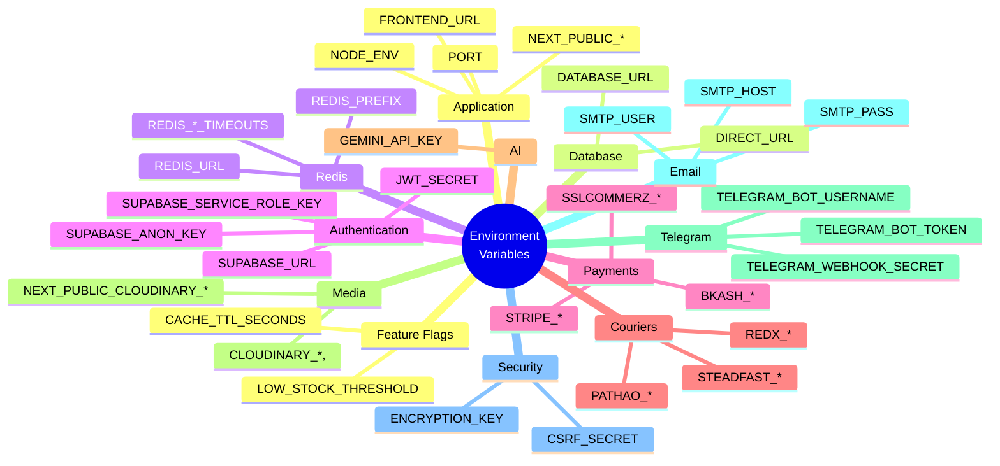

# Environment Variables

## Executive Summary

LofiMart requires 70+ environment variables across 12 categories: application, database, Redis, authentication, payment gateways, courier services, AI, media, Telegram, email, and security. All sensitive values must be stored securely and never committed to version control.

---

## Environment Categories

---

## Application

| Variable | Required | Default | Description |
|----------|----------|---------|-------------|
| `NODE_ENV` | Yes | `development` | `development` or `production` |
| `PORT` | No | `3000` | HTTP server port |
| `FRONTEND_URL` | Yes | — | Base URL (e.g., `https://lofimart.com`) |
| `NEXT_PUBLIC_FRONTEND_URL` | Yes | — | Client-safe base URL |
| `LOW_STOCK_THRESHOLD` | No | `5` | Default low stock alert threshold |
| `CACHE_TTL_SECONDS` | No | `300` | Default cache TTL (5 minutes) |

---

## Database

| Variable | Required | Description |
|----------|----------|-------------|
| `DATABASE_URL` | Yes | PostgreSQL connection string (pooled) |
| `DIRECT_URL` | Yes | PostgreSQL connection string (direct, for migrations) |

**Security Notes:**
- Use connection pooling (PgBouncer) for `DATABASE_URL`
- `DIRECT_URL` bypasses pooling for schema migrations
- Never expose connection strings in client-side code

---

## Redis

| Variable | Required | Default | Description |
|----------|----------|---------|-------------|
| `REDIS_URL` | Yes | — | Redis connection string |
| `REDIS_PREFIX` | No | `lofimart` | Key prefix for namespacing |
| `REDIS_COMMAND_TIMEOUT_MS` | No | `5000` | Command timeout |
| `REDIS_CONNECT_TIMEOUT_MS` | No | `5000` | Connection timeout |
| `REDIS_MAX_RETRIES_PER_REQUEST` | No | `3` | Max retries per request |

**Security Notes:**
- Use TLS for Redis in production
- Set strong Redis password
- Use separate Redis databases for cache vs queues

---

## Authentication (Supabase)

| Variable | Required | Description |
|----------|----------|-------------|
| `SUPABASE_URL` | Yes | Supabase project URL |
| `SUPABASE_ANON_KEY` | Yes | Supabase anonymous/public key |
| `SUPABASE_SERVICE_ROLE_KEY` | Yes | Supabase service role key (server-side only) |

**Security Notes:**
- `SUPABASE_SERVICE_ROLE_KEY` has admin privileges — never expose to client
- `SUPABASE_ANON_KEY` is safe for client-side use
- Rotate keys periodically

---

## JWT & Session

| Variable | Required | Description |
|----------|----------|-------------|
| `JWT_SECRET` | Yes | Secret key for JWT signing (HS256) |
| `CSRF_SECRET` | Yes | Secret key for CSRF token generation |

**Security Notes:**
- Use at least 256-bit random strings
- Rotate secrets quarterly
- Use separate secrets for JWT and CSRF

---

## bKash Payment Gateway

| Variable | Required | Description |
|----------|----------|-------------|
| `BKASH_BASE_URL` | Yes | bKash API base URL |
| `BKASH_USERNAME` | Yes | bKash merchant username |
| `BKASH_PASSWORD` | Yes | bKash merchant password |
| `BKASH_APP_KEY` | Yes | bKash app key |
| `BKASH_APP_SECRET` | Yes | bKash app secret |

**Security Notes:**
- All bKash credentials are server-side only
- Never expose to client-side code
- Use sandbox URL for development

---

## Stripe Payment Gateway

| Variable | Required | Description |
|----------|----------|-------------|
| `STRIPE_SECRET_KEY` | Yes | Stripe secret API key |
| `STRIPE_PUBLISHABLE_KEY` | Yes | Stripe publishable key (client-safe) |
| `STRIPE_WEBHOOK_SECRET` | Yes | Stripe webhook signing secret |

**Security Notes:**
- `STRIPE_SECRET_KEY` is server-side only
- `STRIPE_PUBLISHABLE_KEY` is safe for client-side
- Verify webhook signatures

---

## SSLCommerz Gateway

| Variable | Required | Description |
|----------|----------|-------------|
| `SSLCOMMERZ_STORE_ID` | Yes | SSLCommerz store ID |
| `SSLCOMMERZ_STORE_PASS` | Yes | SSLCommerz store password |
| `SSLCOMMERZ_BASE_URL` | Yes | SSLCommerz API base URL |
| `SSLCOMMERZ_IS_LIVE` | No | `false` for sandbox |

---

## Courier Services

### Pathao

| Variable | Required | Description |
|----------|----------|-------------|
| `PATHAO_CLIENT_ID` | Yes | Pathao OAuth client ID |
| `PATHAO_CLIENT_SECRET` | Yes | Pathao OAuth client secret |
| `PATHAO_BASE_URL` | Yes | Pathao API base URL |
| `PATHAO_USERNAME` | Yes | Pathao merchant username |
| `PATHAO_PASSWORD` | Yes | Pathao merchant password |

### RedX

| Variable | Required | Description |
|----------|----------|-------------|
| `REDX_API_KEY` | Yes | RedX API key |
| `REDX_SECRET_KEY` | Yes | RedX secret key |
| `REDX_BASE_URL` | Yes | RedX API base URL |
| `REDX_BOOKING_ENDPOINT` | Yes | Booking endpoint path |
| `REDX_TRACKING_ENDPOINT` | No | Tracking endpoint path |

### Steadfast

| Variable | Required | Description |
|----------|----------|-------------|
| `STEADFAST_API_KEY` | Yes | Steadfast API key |
| `STEADFAST_SECRET_KEY` | Yes | Steadfast secret key |
| `STEADFAST_BASE_URL` | Yes | Steadfast API base URL |
| `STEADFAST_WEBHOOK_TOKEN` | No | Webhook verification token |

---

## AI Services

| Variable | Required | Description |
|----------|----------|-------------|
| `GEMINI_API_KEY` | Yes | Google Gemini API key |

---

## Media (Cloudinary)

| Variable | Required | Description |
|----------|----------|-------------|
| `NEXT_PUBLIC_CLOUDINARY_CLOUD_NAME` | Yes | Cloudinary cloud name (client-safe) |
| `CLOUDINARY_API_KEY` | Yes | Cloudinary API key (server-side) |
| `CLOUDINARY_API_SECRET` | Yes | Cloudinary API secret (server-side) |

---

## Telegram Bot

| Variable | Required | Description |
|----------|----------|-------------|
| `TELEGRAM_BOT_TOKEN` | Yes | Telegram bot token |
| `TELEGRAM_BOT_USERNAME` | Yes | Telegram bot username (e.g., `@lofimart_bot`) |
| `TELEGRAM_WEBHOOK_SECRET` | No | Webhook secret token validation |

---

## Email (SMTP)

| Variable | Required | Description |
|----------|----------|-------------|
| `SMTP_HOST` | Yes | SMTP server hostname |
| `SMTP_PORT` | No | SMTP port (default: 587) |
| `SMTP_USER` | Yes | SMTP username |
| `SMTP_PASS` | Yes | SMTP password |
| `SMTP_FROM` | Yes | Sender email address |

---

## Security Best Practices

### Secrets Management

| Practice | Description |
|----------|-------------|
| Never commit `.env` | `.env` is in `.gitignore` |
| Use `.env.example` | Template without real values |
| Separate environments | `.env.development`, `.env.production` |
| Rotate regularly | Rotate secrets quarterly |
| Minimum privilege | Use service role keys only when needed |
| No client exposure | Server-only secrets never in `NEXT_PUBLIC_*` |

### Variable Classification

| Classification | Examples | Handling |
|---------------|----------|----------|
| **Public** | `NEXT_PUBLIC_*` | Safe in client bundle |
| **Secret** | `JWT_SECRET`, `*_SECRET_KEY` | Server-only, never in client |
| **Credential** | `DATABASE_URL`, `REDIS_URL` | Infrastructure secrets |
| **API Key** | `*_API_KEY` | External service access |

---

## Development vs Production

| Variable | Development | Production |
|----------|-------------|------------|
| `NODE_ENV` | `development` | `production` |
| `DATABASE_URL` | Local PostgreSQL | Cloud PostgreSQL |
| `REDIS_URL` | Local Redis | Cloud Redis |
| `BKASH_BASE_URL` | Sandbox | Production |
| `STRIPE_SECRET_KEY` | `sk_test_*` | `sk_live_*` |
| `SSLCOMMERZ_IS_LIVE` | `false` | `true` |

---

## Known Limitations

1. No secrets rotation automation
2. No vault integration (HashiCorp Vault, AWS Secrets Manager)
3. No environment variable validation at startup
4. No encrypted `.env` files for team sharing
5. No runtime configuration updates

## Future Improvements

1. Add startup validation for required environment variables
2. Integrate with secrets manager (AWS SSM, Vault)
3. Implement automatic secret rotation
4. Add encrypted `.env` sharing for team development
5. Create environment-specific feature flags
