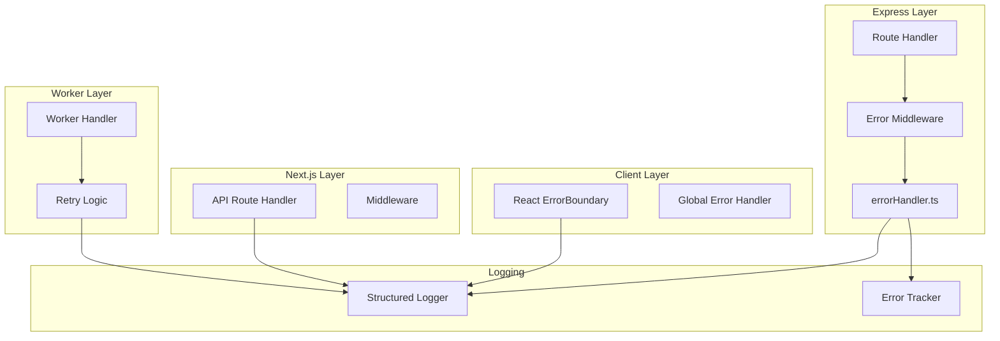
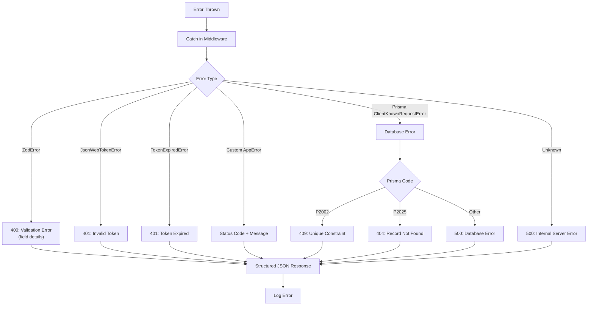
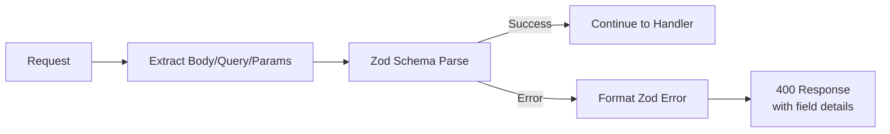
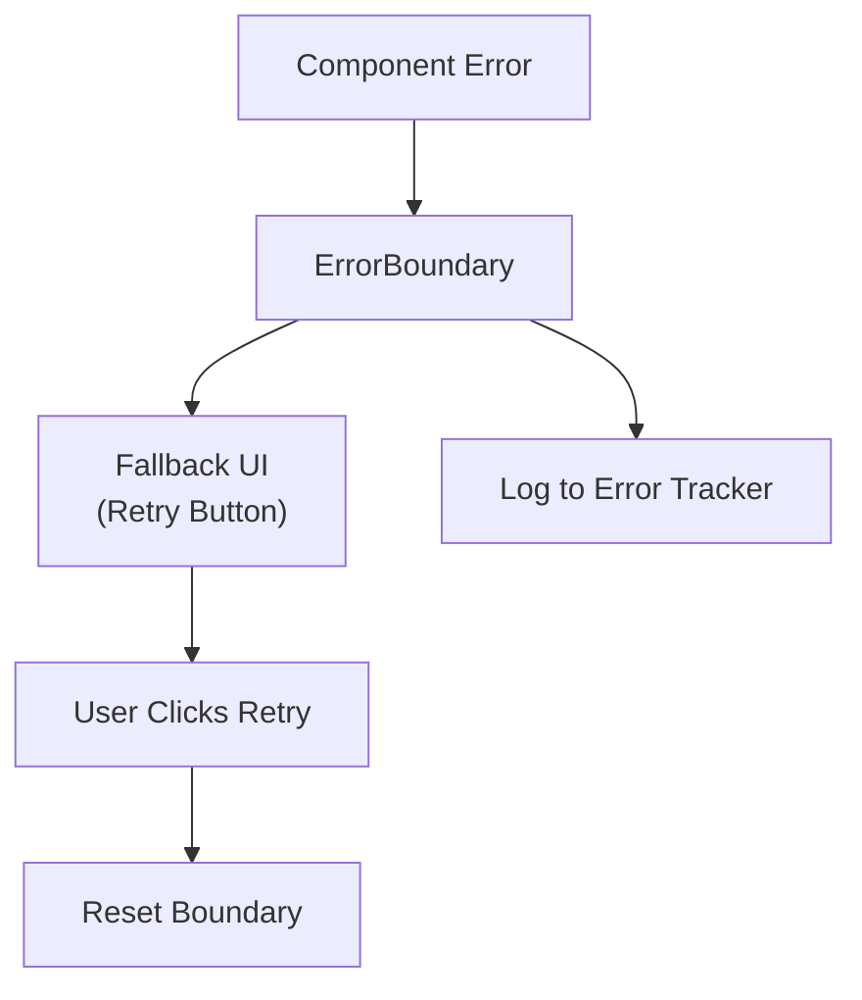
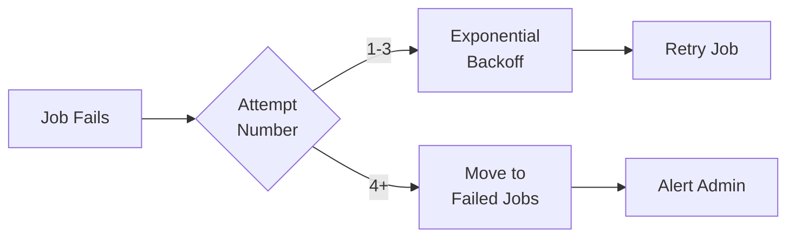

# Error Handling

## Executive Summary

LofiMart implements a multi-layered error handling strategy across Express middleware, Next.js API routes, React components, and background workers. The system uses structured error responses, centralized error tracking, graceful degradation, and comprehensive logging.

---

## Error Handling Architecture



---

## Express Error Middleware

**File:** `src/server/middleware/errorHandler.ts`



### Error Response Format

```json
{
  "success": false,
  "error": {
    "code": "VALIDATION_ERROR",
    "message": "Invalid input data",
    "details": [
      {
        "field": "email",
        "message": "Invalid email format"
      }
    ]
  }
}
```

---

## API Response Utility

**File:** `src/lib/api-response.ts`

```typescript
// Standardized response helpers
export function apiSuccess(data, meta?) {
  return { success: true, data, ...meta };
}

export function apiError(code, message, details?) {
  return { success: false, error: { code, message, details } };
}
```

---

## HTTP Status Codes Used

| Code | Usage |
|------|-------|
| 200 | Success |
| 201 | Created |
| 204 | No Content (preflight) |
| 400 | Validation Error |
| 401 | Unauthorized (no token) |
| 403 | Forbidden (insufficient role) |
| 404 | Not Found |
| 409 | Conflict (duplicate) |
| 422 | Unprocessable Entity |
| 429 | Rate Limited |
| 500 | Internal Server Error |
| 502 | Bad Gateway (external service) |
| 503 | Service Unavailable |

---

## Validation Errors

**File:** `src/server/middleware/validation.ts`



**Zod Error Response:**
```json
{
  "success": false,
  "error": {
    "code": "VALIDATION_ERROR",
    "message": "Validation failed",
    "details": [
      { "field": "email", "message": "Invalid email" },
      { "field": "password", "message": "Too short" }
    ]
  }
}
```

---

## Prisma Database Errors

| Prisma Code | HTTP Status | Message |
|-------------|-------------|---------|
| P2002 | 409 | Unique constraint violation |
| P2025 | 404 | Record not found |
| P2003 | 400 | Foreign key constraint failed |
| P2014 | 400 | Required relation violation |
| P2016 | 400 | Query interpretation error |
| Other | 500 | Database error |

---

## Authentication Errors

| Error | Status | Response |
|-------|--------|----------|
| No token provided | 401 | `{ error: "No token provided" }` |
| Invalid token | 401 | `{ error: "Invalid token" }` |
| Expired token | 401 | `{ error: "Token expired" }` |
| Session not found | 401 | `{ error: "Session invalidated" }` |
| Insufficient role | 403 | `{ error: "Insufficient permissions" }` |
| Account locked | 429 | `{ error: "Account temporarily locked" }` |

---

## Rate Limiting Errors

```json
{
  "success": false,
  "error": {
    "code": "RATE_LIMITED",
    "message": "Too many requests. Please try again later.",
    "retryAfter": 900
  }
}
```

---

## React Error Boundaries

**File:** `src/components/ErrorBoundary.tsx`



---

## BullMQ Worker Errors

### Retry Strategy



| Queue | Max Retries | Backoff |
|-------|-------------|---------|
| order-processing | 3 | Exponential (1s, 2s, 4s) |
| payment-processing | 3 | Exponential (2s, 4s, 8s) |
| email | 2 | Linear (30s, 60s) |
| notifications | 2 | Linear (10s, 20s) |
| inventory-alerts | 1 | Immediate |
| cache-warmup | 1 | Immediate |
| stock-updates | 2 | Linear (5s, 10s) |
| cart-recovery | 1 | Delayed (configurable) |
| analytics | 1 | Immediate |

---

## External Service Errors

### bKash API Errors

```typescript
class BkashApiError extends Error {
  statusCode?: string;    // bKash-specific code
  httpStatus?: number;    // HTTP status
  payload?: unknown;      // Raw response
}
```

| Scenario | Handling |
|----------|----------|
| 401/403 | Re-grant token, retry once |
| Network timeout | 30s timeout, return error |
| Invalid response | Parse safely, return error |

### Courier API Errors

All courier adapters follow:
1. HTTP status check
2. Response payload parsing
3. Error message extraction
4. Structured error propagation

---

## Logging

**File:** `src/lib/logger.ts`

Structured JSON logging with levels:
- `info` — Normal operations
- `warn` — Recoverable issues
- `error` — Unrecoverable errors
- `debug` — Development details

**Log Format:**
```json
{
  "level": "error",
  "message": "payments.bkash.token.refresh_failed",
  "metadata": {
    "error": "Token refresh failed",
    "orderId": "clx123abc",
    "paymentId": "bkash_abc123"
  },
  "timestamp": "2026-07-22T22:00:00.000Z"
}
```

---

## Error Tracking

**File:** `src/features/shared/services/monitoring/errorTracker.ts`

```typescript
captureError(error, { scope: 'payment', metadata: { orderId } });
```

Errors captured with context scope and metadata for debugging.

---

## Best Practices

1. **Always return structured errors** — Never expose raw stack traces
2. **Use appropriate HTTP status codes** — Don't return 200 for errors
3. **Log all errors** — Include context metadata
4. **Implement retry with backoff** — For transient failures
5. **Graceful degradation** — Fall back to alternatives when possible
6. **User-friendly messages** — Map technical errors to readable messages
7. **Idempotent error handling** — Same error should produce same result
8. **Circuit breaker pattern** — Stop calling failing external services

## Known Limitations

1. No centralized error dashboard
2. No real-time error alerting (Sentry/Datadog)
3. No distributed tracing
4. Error messages sometimes leak implementation details
5. No automatic error grouping/deduplication

## Future Improvements

1. Integrate Sentry or Datadog for error tracking
2. Implement circuit breaker pattern for external services
3. Add distributed tracing (OpenTelemetry)
4. Create error dashboard for monitoring
5. Implement automatic error grouping
