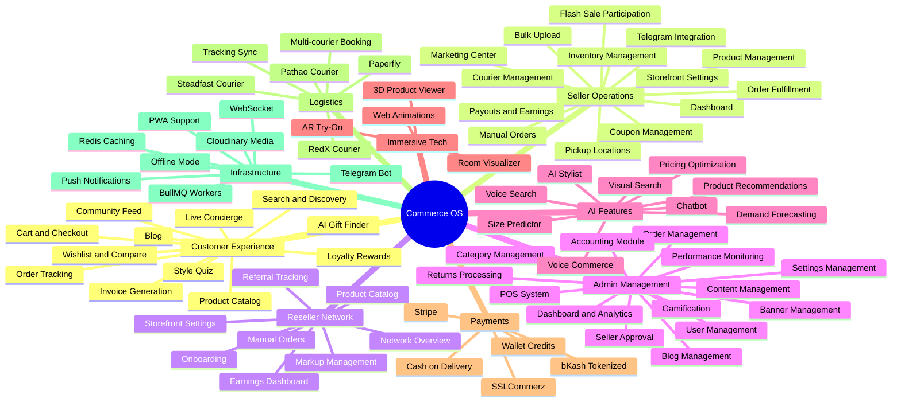

# Platform Features

## Executive Summary

LofiMart is a comprehensive multi-vendor ecommerce platform with 30+ feature modules spanning customer experience, seller operations, admin management, AI capabilities, logistics, payments, and immersive technologies.

---

## Feature Map

---

## Customer Dashboard Features

| Feature | Description | Page |
|---------|-------------|------|
| Dashboard | Order summary, recent activity, rewards | /account/dashboard |
| Orders | Order history with status tracking | /account/orders |
| Order Details | Full order info, invoice, tracking | /account/orders/[id] |
| Invoice | Downloadable PDF invoice | /account/orders/[id]/invoice |
| Wishlist | Saved products with quick add-to-cart | /account/wishlist |
| Wallet | Balance, transaction history, credits | /account/wallet |
| Rewards | Points balance, reward history | /account/rewards |
| Addresses | Manage shipping addresses | /account/addresses |
| Notifications | Read/unread notifications | /account/notifications |
| Settings | Profile, password, preferences | /account/settings |

---

## Seller Dashboard Features

| Feature | Description | Page |
|---------|-------------|------|
| Dashboard | AI-powered insights, health signals | /seller/dashboard |
| Products | Product list, add/edit/delete | /seller/products |
| Add Product | New product form with media upload | /seller/products/add |
| Bulk Upload | CSV/batch product import | /seller/products/bulk |
| Edit Product | Product edit with variant management | /seller/products/edit/[id] |
| Orders | Order management, accept/reject/ship | /seller/orders |
| Inventory | Stock levels across warehouses | /seller/inventory |
| Manual Orders | Create orders on behalf of customers | /seller/manual-orders |
| Courier | Multi-courier shipment booking | /seller/courier |
| Marketing | Marketing center hub | /seller/marketing |
| Ads | Advertising management | /seller/marketing/ads |
| Coupons | Create and manage discount codes | /seller/marketing/coupons |
| Promotions | Promotion campaigns | /seller/marketing/promotions |
| Flash Sale | Flash sale participation | /seller/flash-sale |
| Earnings | Revenue summary, commission details | /seller/earnings |
| Payouts | Payout history, withdrawal requests | /seller/payouts |
| Analytics | Performance reports | /seller/analytics |
| Reports | Detailed sales analytics | /seller/analytics/reports |
| Pickup Locations | Warehouse/pickup point config | /seller/pickup-locations |
| Notifications | Order alerts, system notifications | /seller/notifications |
| Support Tickets | Customer support management | /seller/support/tickets |
| Reviews | Product review management | /seller/support/reviews |
| Returns | Return request handling | /seller/support/returns |
| Settings | Profile, store settings | /seller/settings |
| Vacation Mode | Temporary store pause | /seller/settings/vacation |
| Onboarding | Step-by-step store setup | /seller/onboarding |

---

## Admin Dashboard Features

| Feature | Description | Page |
|---------|-------------|------|
| Dashboard | Platform overview, key metrics | /admin/dashboard |
| Analytics | Performance monitoring | /admin/performance |
| Users | User management, role changes | /admin/users |
| Sellers | Seller approval, management | /admin/sellers |
| Products | Product catalog management | /admin/products |
| Orders | Order management, fulfillment | /admin/orders |
| Returns | Return/refund processing | /admin/returns |
| Payments | Revenue, refunds, payouts | /admin/payments |
| Accounting | Double-entry bookkeeping | /admin/accounting |
| Inventory | Warehouse management | /admin/inventory |
| Logistics | Courier diagnostics | /admin/logistics |
| POS | Point of Sale system | /admin/pos |
| Reviews | Review moderation | /admin/reviews |
| Coupons | Platform-wide coupons | /admin/coupons |
| Flash Sale | Flash sale management | /admin/flash-sale |
| Banners | Homepage banner management | /admin/banners |
| Blog | Blog post management | /admin/blog |
| Categories | Category tree management | /admin/categories |
| Community | Community post moderation | /admin/community |
| Gamification | Rewards, spins, missions | /admin/gamification |
| Settings | Platform configuration | /admin/settings |
| About | About page content | /admin/about |
| Support | Support ticket management | /admin/support |
| Integrations | Third-party status | /admin/integrations |

---

## AI Features

| Feature | Powered By | Endpoint |
|---------|-----------|----------|
| AI Chatbot | Google Gemini | POST /api/ai/chatbot |
| Product Recommendations | Algorithm (4 types) | GET /api/ai/recommendations |
| Size Predictor | Algorithm | Hook: useSizePredictor |
| AI Stylist | Gemini + Preferences | Hook: useAIStylist |
| Visual Search | Simulated image matching | GET /api/ai/visual-search |
| Voice Commerce | Web Speech API | Hook: useVoiceCommerce |
| Voice Search | Web Speech API | Hook: useVoiceSearch |
| Pricing Optimization | Algorithm | GET /api/ai/pricing/suggestions |
| Demand Forecasting | Algorithm | GET /api/ai/pricing/demand |

---

## Immersive Technology Features

| Feature | Description |
|---------|-------------|
| AR Try-On | Camera-based product visualization |
| 3D Product Viewer | Interactive 3D model viewing with scene setup |
| Room Visualizer | Place products in real room context |
| Web Animations | Page transitions, scroll animations, micro-interactions |

---

## PWA Features

| Feature | Description |
|---------|-------------|
| Offline Indicator | Shows when user is offline |
| Install Prompt | Native app install prompt |
| Push Notifications | Web push notification support |
| Offline Storage | Local data persistence |

---

## Telegram Bot Features

| Feature | Description |
|---------|-------------|
| Order Notifications | New order alerts to sellers |
| Order Management | Accept/reject/ship via bot |
| Invoice Delivery | PDF invoice sending |
| Low Stock Alerts | Inventory threshold warnings |
| Webhook Handling | Courier status updates |
| Deep Links | Direct dashboard links |

---

## Bazaar (Marketplace Discovery)

| Feature | Description | Page |
|---------|-------------|------|
| Affiliate Catalog | Curated product collections | /bazaar/affiliate-catalog |
| AI Gift Finder | AI-powered gift recommendations | /bazaar/aigiftfinder |
| Live Concierge | Real-time shopping assistance | /bazaar/liveconcierge |
| Loyalty Rewards | Points and reward programs | /bazaar/loyalty-rewards |
| Reseller Discovery | Find reseller storefronts | /bazaar/reseller-discovery |

---

## Third-Party Integrations

| Integration | Type | Purpose |
|------------|------|---------|
| Supabase | Auth | OAuth, email/password authentication |
| Google Gemini | AI | Chatbot, stylist, recommendations |
| Cloudinary | Media | Image upload, optimization, transformation |
| bKash | Payment | Mobile financial service (Bangladesh) |
| Stripe | Payment | International card payments |
| SSLCommerz | Payment | Gateway for card/bank payments |
| Pathao | Courier | Last-mile delivery (Bangladesh) |
| RedX | Courier | Parcel delivery service |
| Steadfast | Courier | Courier and logistics |
| Telegram | Bot | Order notifications, seller management |

---

## Best Practices

1. Feature modules follow consistent pattern: screens/, components/, services/, hooks/
2. Progressive Enhancement: Core features work without JavaScript
3. Mobile-First: All dashboards and storefronts are responsive
4. Performance: Lazy loading, code splitting per feature module
5. Accessibility: ARIA labels, keyboard navigation support

## Known Limitations

1. No multi-language support (Bangladesh market only)
2. No native mobile apps (PWA only)
3. No subscription products (one-time purchases only)
4. No digital product delivery (physical goods only)
5. Limited AR/3D (demo/prototype stage)

## Future Improvements

1. Native iOS/Android apps via React Native
2. Multi-language support (Bangla, Arabic)
3. Subscription/recurring billing
4. Digital product delivery
5. Advanced AR with product placement
6. Social commerce integrations

---
