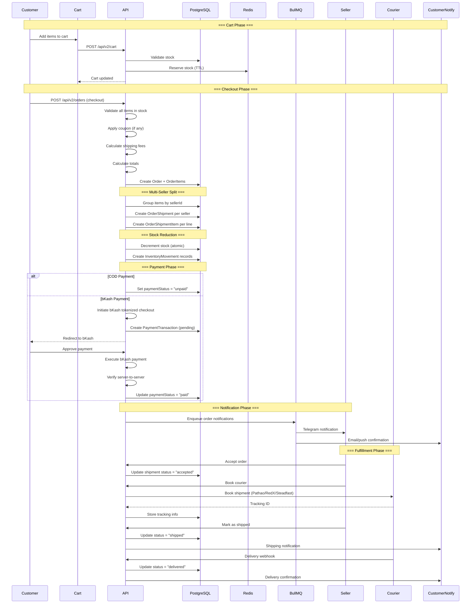
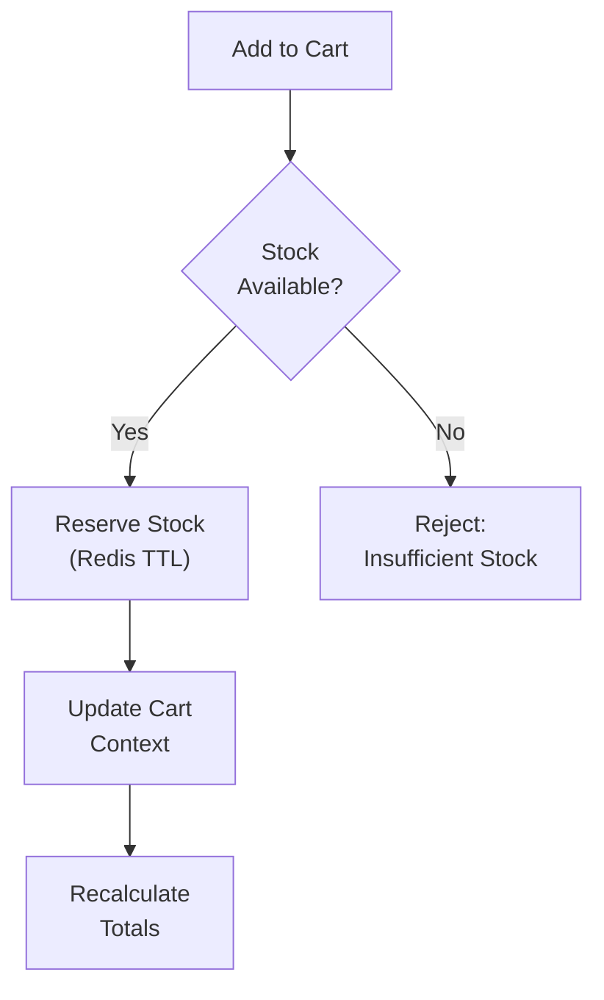
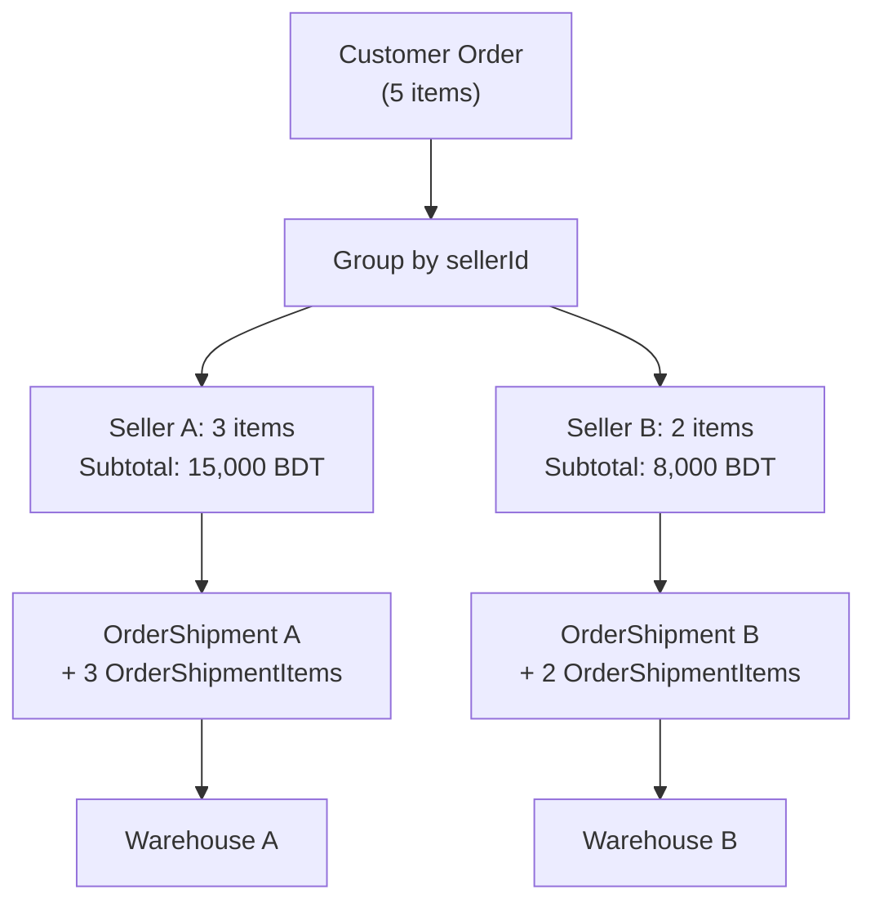
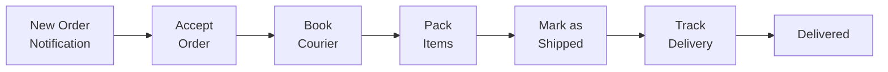
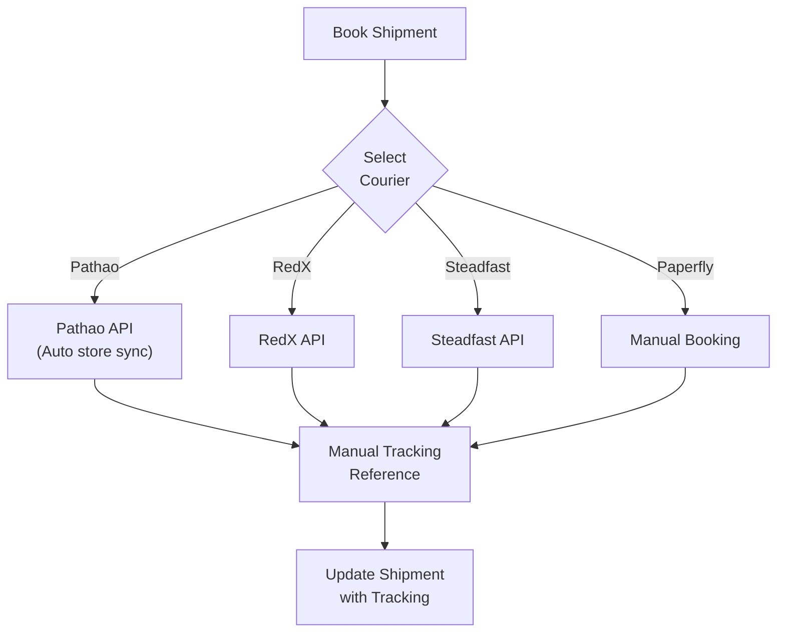
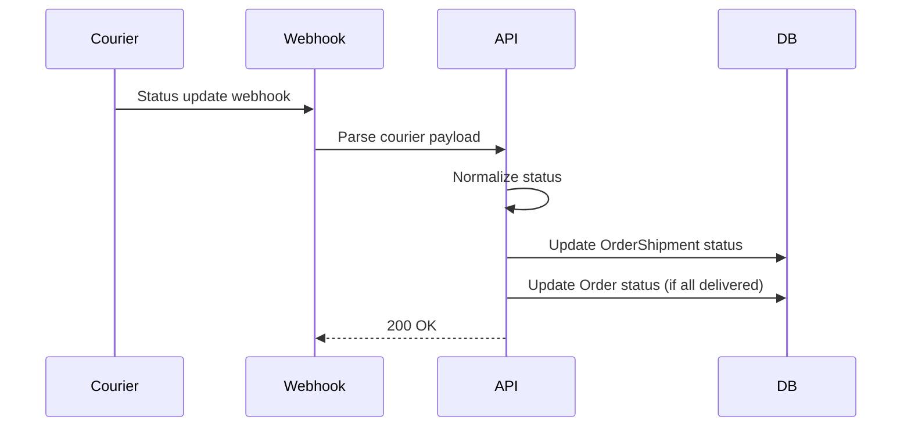
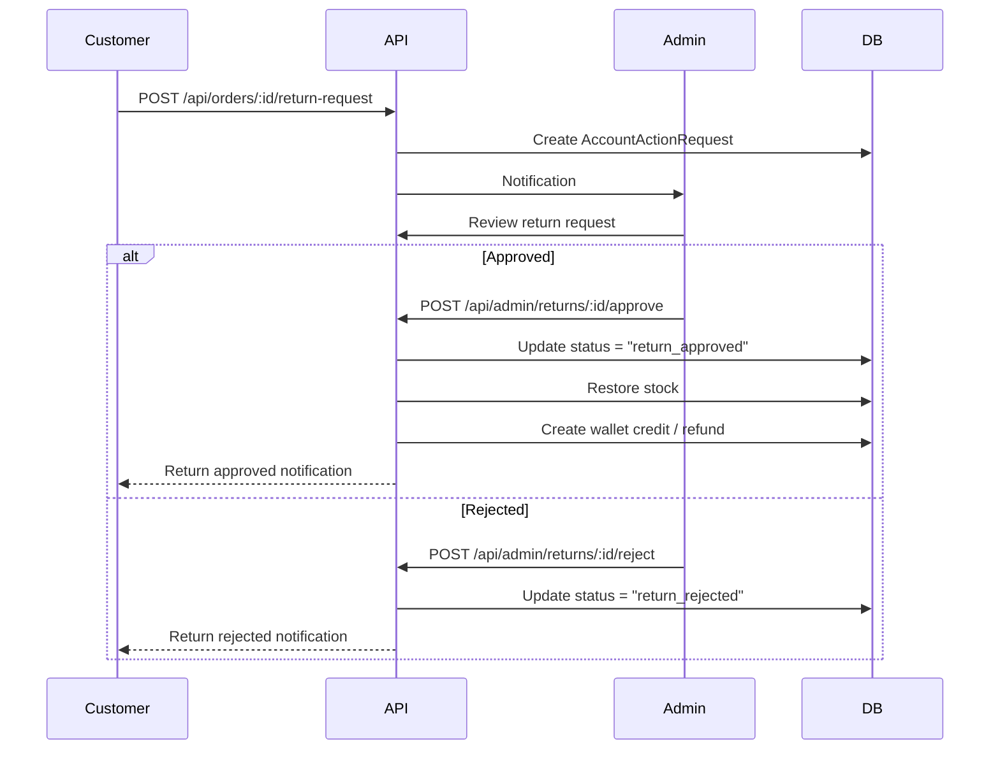
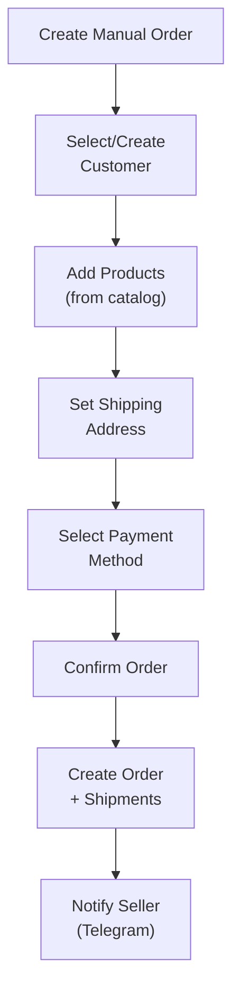

# Order Flow

## Executive Summary

LofiMart's order flow handles the complete lifecycle from cart to delivery, including multi-vendor order splitting, stock reservation, payment processing, courier booking, and real-time status tracking. Orders are automatically split by seller, with each seller managing their own shipment independently.

---

## End-to-End Order Flow



---

## Cart Phase

### Adding to Cart


### Stock Reservation Rules
- Stock reserved in Redis with configurable TTL
- Reservation released if checkout not completed within TTL
- Reserved stock visible to other users as "in cart"
- Atomic decrement on actual order creation

---

## Checkout Phase

### Order Validation
1. All cart items validated for stock availability
2. Shipping address validated (required fields)
3. Payment method validated against enabled methods
4. Coupon validated (if provided): code, expiry, minimum order, seller match
5. Shipping fees calculated per seller/warehouse
6. Tax calculated (if applicable)

### Order Code Generation
```
Format: ORD-{timestamp}-{random6chars}
Example: ORD-1721500000000-A3X7K9
```

### Multi-Seller Splitting Logic



Each shipment:
- Has its own status lifecycle
- Can be fulfilled independently
- Has separate courier booking
- Tracks its own tracking information

---

## Payment Processing

See [Payment-Flow.md](./Payment-Flow.md) for detailed payment processing.

**Quick Flow:**
1. COD: No online payment → `paymentStatus: "unpaid"`
2. bKash: Initiate → Execute → Verify → `paymentStatus: "paid"`
3. Stripe: Create intent → Confirm → Webhook → `paymentStatus: "paid"`
4. SSLCommerz: Redirect → Callback → Verify → `paymentStatus: "paid"`
5. Wallet: Deduct balance → `paymentStatus: "paid"`

---

## Fulfillment Phase

### Seller Actions



### Courier Booking



### Delivery Tracking



---

## Order Status Updates

### Telegram Bot Integration
Sellers can manage orders via Telegram bot:
1. **Accept:** `order:accept:{orderId}:{sellerId}` callback
2. **Reject:** `order:reject:{orderId}:{sellerId}` callback
3. **Ship:** `order:ship:{orderId}:{sellerId}` callback
4. **Deliver:** `order:deliver:{orderId}:{sellerId}` callback

### Status Notification Chain

| Status | Customer Notified | Seller Notified | Admin Notified |
|--------|------------------|-----------------|----------------|
| Created | ✅ Email/Push | ✅ Telegram | ❌ |
| Paid | ✅ Email | ❌ | ❌ |
| Accepted | ❌ | ✅ Telegram | ❌ |
| Shipped | ✅ Email/Push | ✅ Telegram | ❌ |
| Delivered | ✅ Email/Push | ✅ Telegram | ❌ |
| Cancelled | ✅ Email | ✅ Telegram | ✅ Dashboard |
| Return Requested | ✅ Email | ✅ Telegram | ✅ Dashboard |

---

## Return Flow



---

## Manual Order Flow (Seller/Admin)



---

## Order Invoice Generation

| Step | Action |
|------|--------|
| 1 | Order created → Invoice record auto-created |
| 2 | Invoice URL generated: `/account/orders/{id}/invoice` |
| 3 | PDF endpoint: `/api/orders/{id}/invoice.pdf` |
| 4 | Telegram invoice: Generated via signed URL with HMAC token |
| 5 | Token validity: 7 days, verified server-side |

---

## Best Practices

1. **Atomic stock reduction** — Always use database-level atomic decrement
2. **Transaction safety** — Order creation + stock reduction in single transaction
3. **Idempotent operations** — Payment callbacks must be idempotent
4. **Fail-safe defaults** — If payment verification fails, don't confirm order
5. **Audit trail** — Every status change logged with timestamp and actor

## Known Limitations

1. No partial shipment tracking — All or nothing per seller shipment
2. No split delivery addresses — Single address per order
3. No scheduled deliveries — Immediate processing only
4. No backorder support — Out of stock = cannot order
5. No multi-currency orders — BDT only per tenant

## Future Improvements

1. Partial shipment support with per-item tracking
2. Scheduled delivery date selection
3. Backorder/pre-order support
4. Multi-currency checkout
5. Delivery slot booking
6. Real-time delivery tracking map
