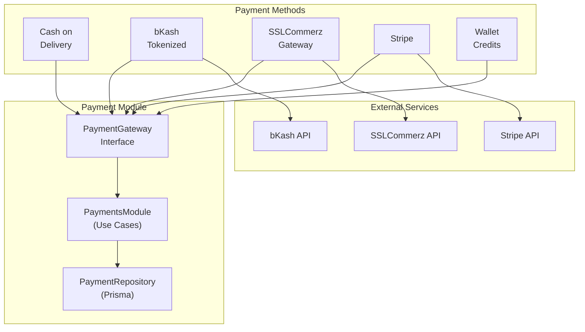
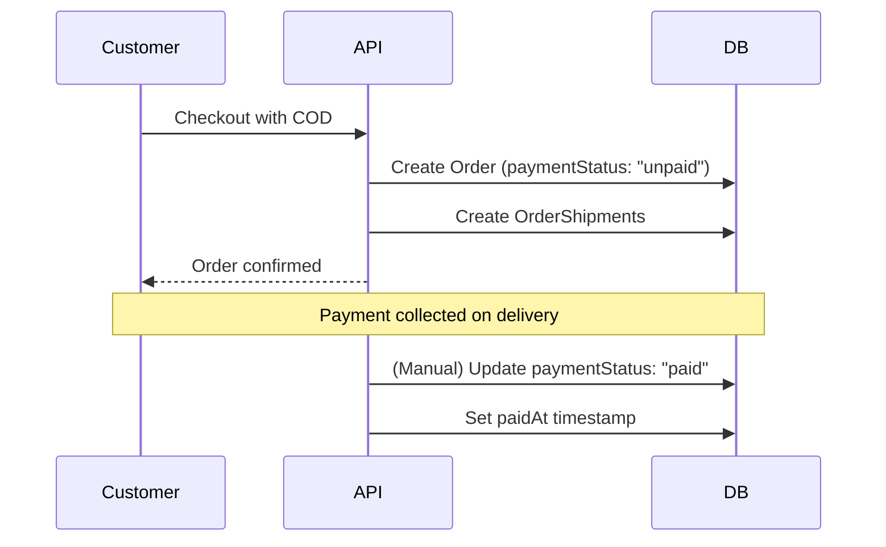
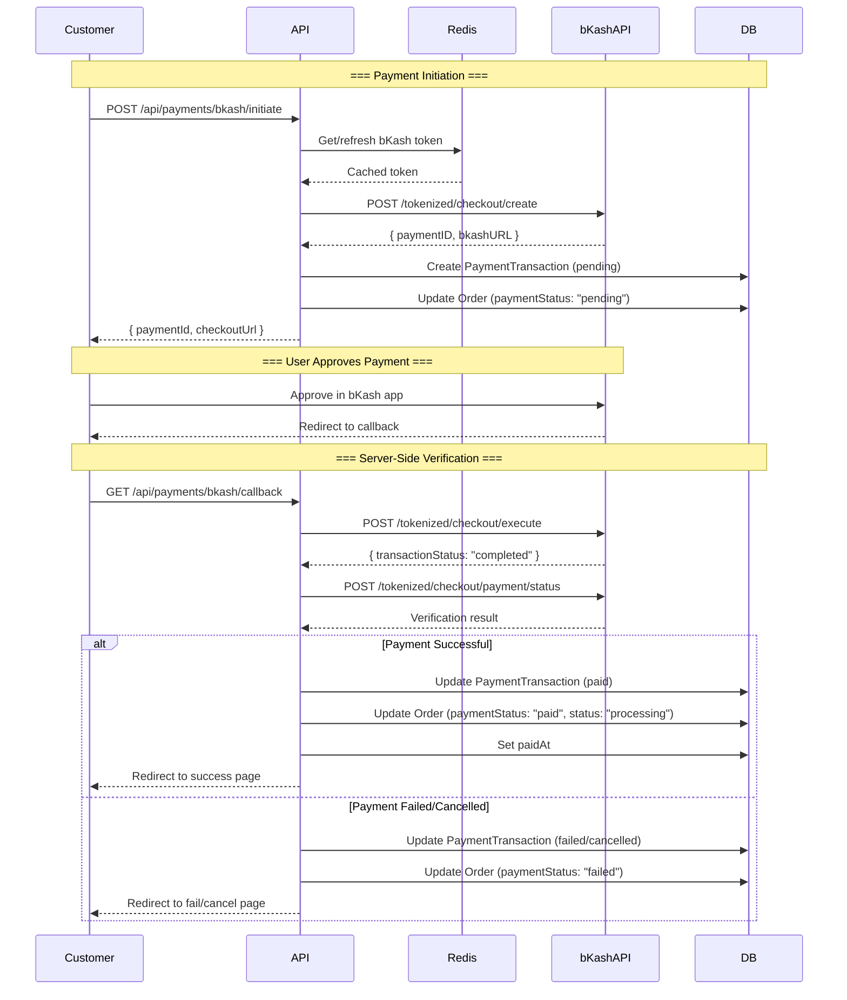
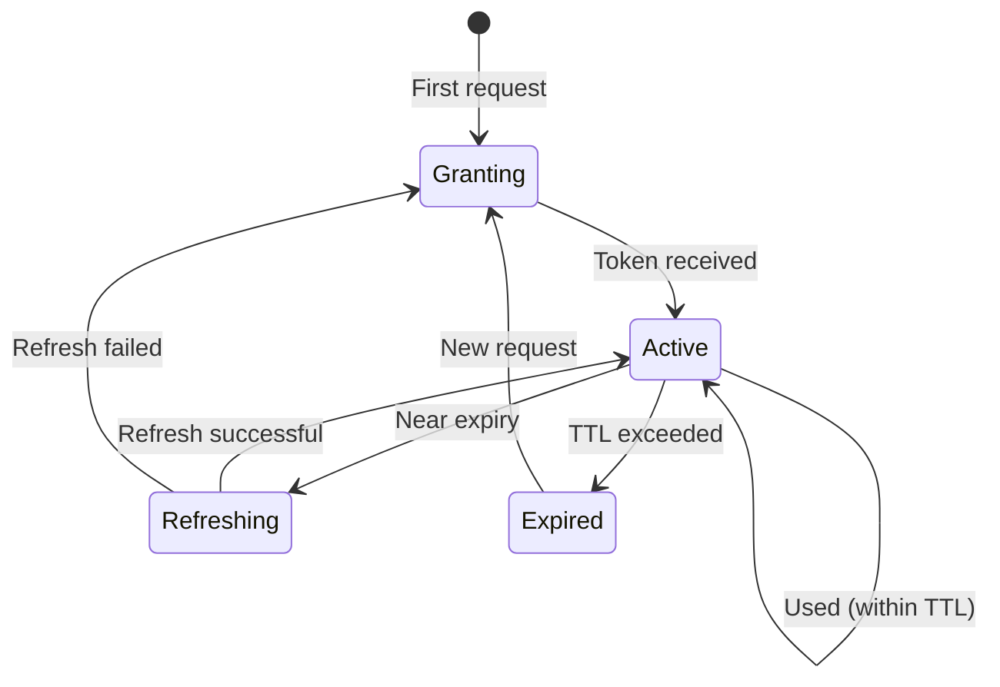
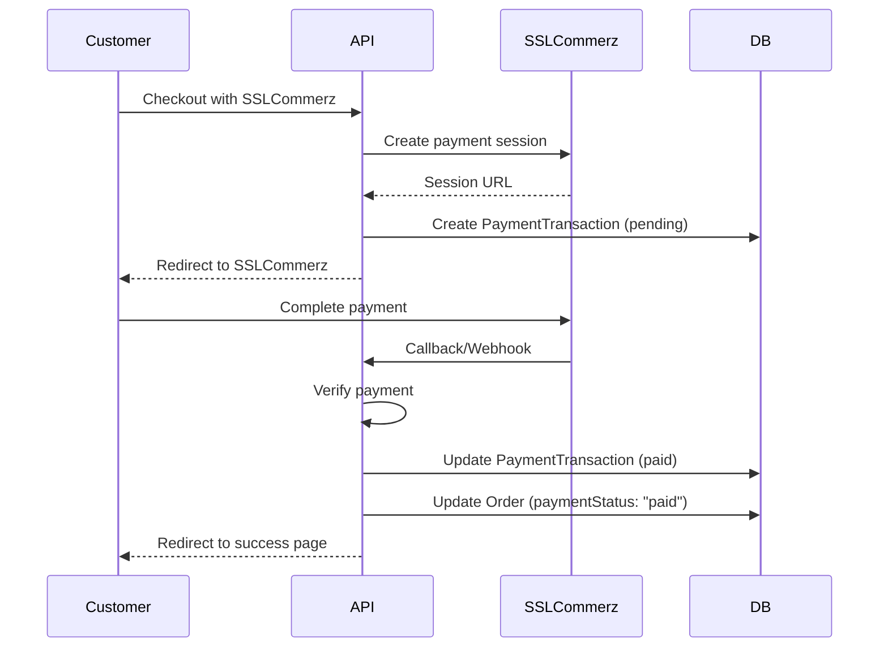
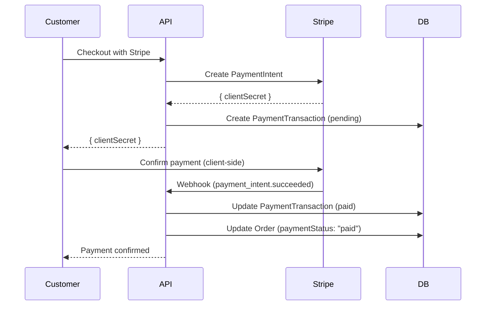
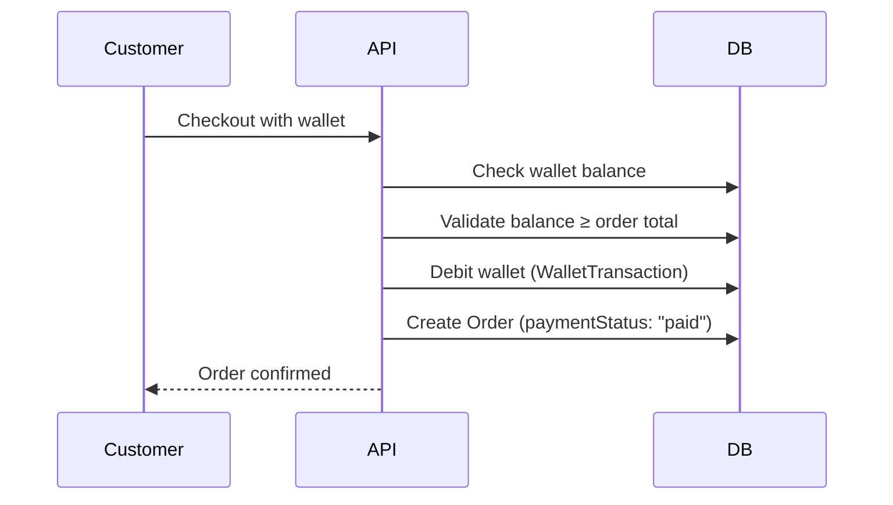
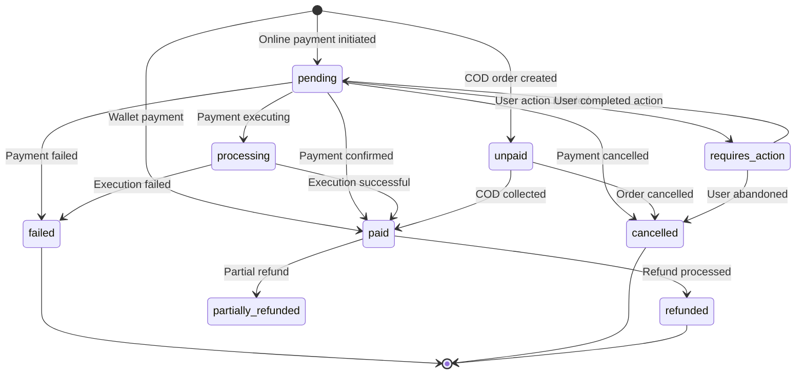
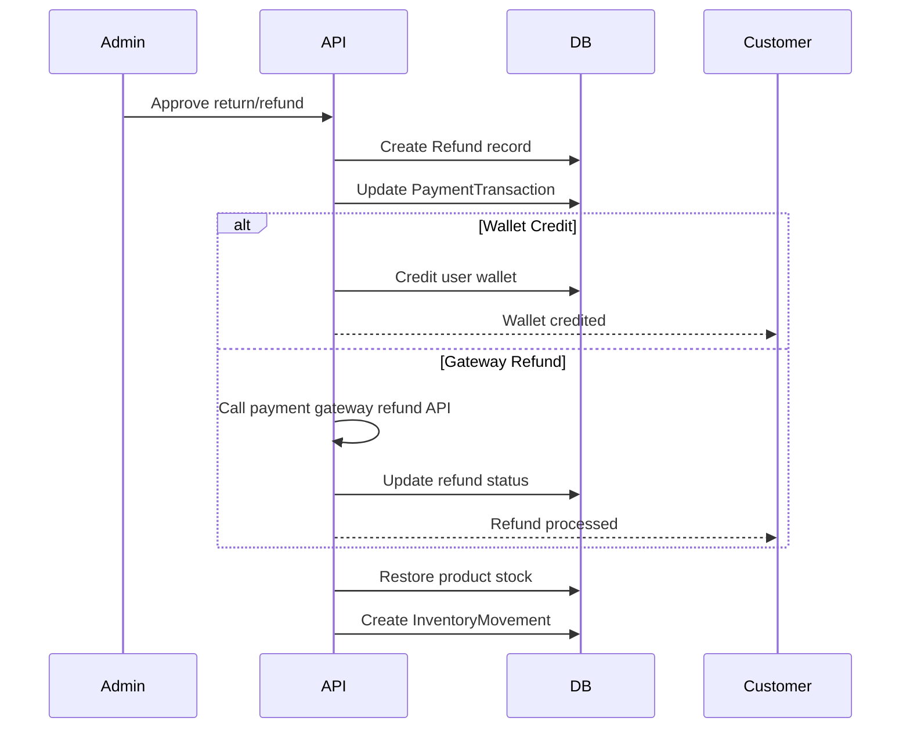
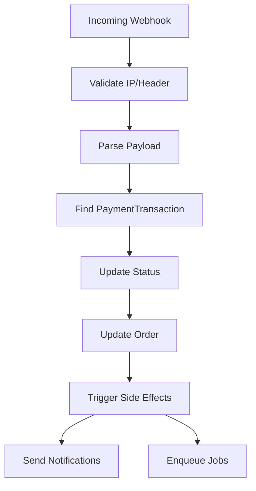

# Payment Flow

## Executive Summary

LofiMart supports 5 payment methods: Cash on Delivery (COD), bKash Tokenized Checkout, SSLCommerz, Stripe, and Wallet Credits. The payment system implements idempotent transaction processing, server-side verification for all online payments, and comprehensive refund/wallet management.

---

## Payment Method Architecture



---

## Cash on Delivery (COD)



**Status:** No online payment processing. Payment collected by courier on delivery.

---

## bKash Tokenized Checkout



### bKash Security Rules
1. **Server-side verification only** — Browser callback never trusted as proof
2. **Execute + Query** — Both execute and query endpoints called for verification
3. **Idempotency key** — Unique per transaction, prevents duplicate charges
4. **Token caching** — Tokens cached in Redis with skew-aware expiry
5. **Auto-retry on auth failure** — 401/403 triggers token re-grant

### bKash Token Lifecycle



---

## SSLCommerz Gateway



---

## Stripe Gateway



---

## Wallet Payment



**Rules:**
- Balance must be ≥ order total
- Atomic wallet debit in transaction
- Transaction recorded with `balanceAfter`

---

## Payment State Machine



---

## Refund Processing



---

## Payment Transaction Model

```typescript
PaymentTransaction {
  id: string (cuid)
  provider: string          // 'bkash' | 'stripe' | 'sslcommerz' | 'cod' | 'wallet'
  paymentId: string (unique) // Provider's payment reference
  orderId: string            // FK to Order
  customerId: string
  amount: Decimal
  currency: string           // 'BDT'
  status: string             // 'pending' | 'paid' | 'failed' | 'cancelled' | 'refunded'
  idempotencyKey: string (unique)
  metadata: JSON             // Provider-specific data
  createdAt: DateTime
  updatedAt: DateTime
}
```

---

## Webhook Handling

### Generic Webhook Flow



### Supported Webhooks
| Provider | Endpoint | Events |
|----------|----------|--------|
| bKash | `/api/payments/bkash/webhook` | Payment status updates |
| bKash | `/api/payments/bkash/callback` | User redirect callback |
| Stripe | `/api/payments/stripe/webhook` | payment_intent.succeeded, charge.refunded |
| Pathao | `/api/logistics/webhook/pathao` | Delivery status updates |
| RedX | `/api/logistics/webhook/redx` | Tracking updates |
| Steadfast | `/api/logistics/webhook/steadfast` | Delivery status updates |

---

## Commerce Channel Configuration

Payment methods can be dynamically enabled/disabled via platform settings:

```
PlatformSetting keys:
- enabled_checkout_payment_methods: "cod,bkash,stripe,sslcommerz"
- enabled_manual_order_payment_methods: "cod,bkash,manual"
- enabled_courier_providers: "pathao,redx,steadfast,paperfly"
```

---

## Best Practices

1. **Server-side verification** — Never trust client-side payment confirmation
2. **Idempotency keys** — Prevent duplicate payment processing
3. **Atomic transactions** — Payment update + order update in single DB transaction
4. **Webhook signature verification** — Validate all incoming webhooks
5. **Timeout handling** — Set appropriate timeouts for external API calls
6. **Retry logic** — Implement exponential backoff for failed API calls
7. **Audit trail** — Log all payment events with full context

## Known Limitations

1. No split payments across multiple methods
2. No partial payments (pay now, pay later)
3. No recurring/subscription billing
4. No saved payment methods (tokenization)
5. No multi-currency support within single transaction

## Future Improvements

1. Split payment support
2. Saved payment method tokenization
3. Recurring billing engine
4. Multi-currency checkout
5. Payment analytics dashboard
6. Fraud detection integration
