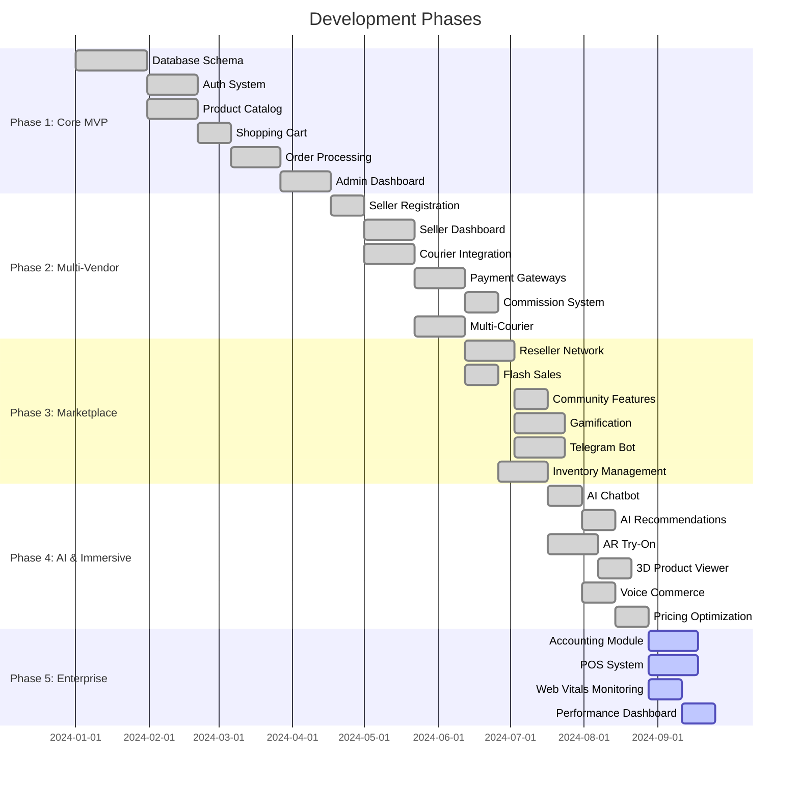

# Development Phases & Roadmap

## Executive Summary

LofiMart has evolved through 4 major development phases, from initial MVP to a feature-rich multi-vendor marketplace. This document outlines completed phases, current capabilities, and the planned roadmap for future development.

---

## Phase Timeline

---

## Phase 1: Core MVP (Completed)

**Goal:** Foundation for ecommerce operations

### Deliverables
| Feature | Status | Description |
|---------|--------|-------------|
| Database Schema | ✅ | PostgreSQL with Prisma ORM, 72 models |
| Authentication | ✅ | Email/password + Supabase OAuth |
| Product Catalog | ✅ | CRUD with categories, search, filters |
| Shopping Cart | ✅ | Client-side cart with persistence |
| Order Processing | ✅ | Multi-step checkout flow |
| Admin Dashboard | ✅ | Basic platform management |
| User Management | ✅ | Registration, profiles, addresses |

### Tech Stack Established
- Next.js App Router + Express.js dual stack
- PostgreSQL + Prisma ORM
- Redis for caching/sessions
- JWT + Redis session management

---

## Phase 2: Multi-Vendor (Completed)

**Goal:** Enable multiple sellers on the platform

### Deliverables
| Feature | Status | Description |
|---------|--------|-------------|
| Seller Registration | ✅ | Multi-role signup (customer/seller/reseller) |
| Seller Dashboard | ✅ | Product, order, analytics management |
| Courier Integration | ✅ | Pathao, RedX, Steadfast, Paperfly |
| Payment Gateways | ✅ | bKash, Stripe, SSLCommerz, COD |
| Commission System | ✅ | Per-order platform commission |
| Multi-Seller Orders | ✅ | Automatic order splitting by seller |
| Seller Onboarding | ✅ | Step-by-step store setup wizard |
| Seller Approval | ✅ | Admin review workflow |

---

## Phase 3: Marketplace (Completed)

**Goal:** Community features and growth tools

### Deliverables
| Feature | Status | Description |
|---------|--------|-------------|
| Reseller Network | ✅ | Referral system, markup management |
| Flash Sales | ✅ | Campaign-based flash sale system |
| Community Posts | ✅ | User-generated content with moderation |
| Gamification | ✅ | Login streaks, spin wheel, missions, referrals |
| Telegram Bot | ✅ | Order notifications, management via bot |
| Inventory Management | ✅ | Multi-warehouse, stock tracking, PO system |
| Coupons | ✅ | Percentage/flat discounts per seller |
| Wishlist & Compare | ✅ | Product saving and comparison |
| Blog System | ✅ | CMS for articles and news |

---

## Phase 4: AI & Immersive (Completed)

**Goal:** AI-powered features and immersive experiences

### Deliverables
| Feature | Status | Description |
|---------|--------|-------------|
| AI Chatbot | ✅ | Gemini-powered product assistance |
| AI Recommendations | ✅ | 4 types: personalized, trending, context, collaborative |
| AI Stylist | ✅ | Style-based product suggestions |
| Size Predictor | ✅ | Body measurement-based sizing |
| Voice Commerce | ✅ | Voice-based product search |
| Voice Search | ✅ | Speech-to-text search |
| AR Try-On | ✅ | Camera-based product visualization |
| 3D Product Viewer | ✅ | Interactive 3D model viewing |
| Room Visualizer | ✅ | Place products in room context |
| Visual Search | ✅ | Image-based product matching |
| Pricing Optimization | ✅ | AI-driven price suggestions |
| Demand Forecasting | ✅ | Sales trend prediction |

---

## Phase 5: Enterprise (In Progress)

**Goal:** Advanced business tools and monitoring

### Deliverables
| Feature | Status | Description |
|---------|--------|-------------|
| Accounting Module | 🔄 | Double-entry bookkeeping (ledger, journals) |
| POS System | 🔄 | Point of Sale for in-store transactions |
| Web Vitals Dashboard | 🔄 | Performance monitoring with alerts |
| Performance Monitor | 🔄 | Real-time metrics and alerting |
| Invoice Generation | 🔄 | PDF invoice generation |
| Payout Management | 🔄 | Automated seller payout processing |
| Verification System | 🔄 | Seller identity verification with documents |
| Risk Assessment | 🔄 | User risk flagging system |

---

## Phase 6: Scale (Planned)

**Goal:** Production readiness and scalability

### Planned Features
| Feature | Priority | Description |
|---------|----------|-------------|
| Read Replicas | High | PostgreSQL read replicas for scaling |
| API Rate Limiting v2 | High | Per-user rate limits with Redis |
| CDN for API | Medium | Edge caching for public APIs |
| GraphQL API | Medium | Flexible data querying |
| WebSocket Auth | High | JWT validation on WS connections |
| Blue-Green Deploy | Medium | Zero-downtime deployments |
| Kubernetes | Medium | Container orchestration |
| OpenTelemetry | High | Distributed tracing |
| Sentry Integration | High | Error tracking and alerting |
| Grafana Dashboards | Medium | Real-time monitoring |

---

## Phase 7: Growth (Planned)

**Goal:** International expansion and advanced features

### Planned Features
| Feature | Priority | Description |
|---------|----------|-------------|
| Multi-Language | High | Bangla, Arabic, English |
| Multi-Currency | Medium | Support for multiple currencies |
| Native Mobile Apps | High | React Native iOS/Android |
| Social Commerce | Medium | Facebook/Instagram selling |
| Subscription Billing | Medium | Recurring products |
| Digital Products | Low | E-books, courses, software |
| Marketplace for Services | Low | Service provider listings |
| Advanced Analytics | Medium | Business intelligence dashboard |
| Fraud Detection | High | AI-powered fraud prevention |
| Inventory Forecasting | Medium | ML-based demand prediction |

---

## Technology Debt

| Item | Priority | Effort | Impact |
|------|----------|--------|--------|
| Split server.ts into modules | High | Large | Maintainability |
| Add GraphQL layer | Medium | Large | API flexibility |
| Implement CSP headers | High | Small | Security |
| Add E2E tests | High | Large | Reliability |
| WebSocket authentication | High | Small | Security |
| Database migrations automation | Medium | Medium | Deployment |
| API versioning cleanup | Medium | Medium | Stability |
| Remove legacy code paths | Low | Medium | Code hygiene |

---

## Best Practices for Roadmap

1. **Ship incrementally** — Small, frequent releases over big bangs
2. **Measure before building** — Use analytics to validate feature demand
3. **Security first** — Always prioritize security improvements
4. **Automate everything** — CI/CD, testing, deployments
5. **Monitor production** — Don't ship blind

## Known Limitations

1. No formal product management tool (Jira/Linear)
2. No feature flag system for gradual rollouts
3. No A/B testing infrastructure
4. No formal release versioning (semver)

## Future Improvements

1. Implement feature flag system (LaunchDarkly/Unleash)
2. Add formal release management process
3. Create product analytics pipeline
4. Establish SLO/SLA targets
5. Implement automated regression testing
