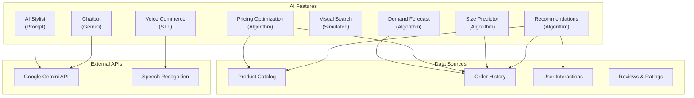
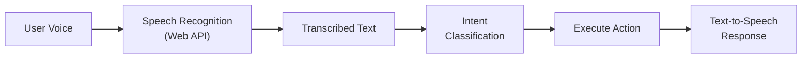

# AI Prompts & Integration Guide

## Executive Summary

LofiMart integrates multiple AI features powered by Google Gemini and custom ML-like systems. This document covers all AI/ML integrations, their prompts, data flows, and configuration.

---

## AI Feature Architecture



---

## AI Chatbot

**Endpoint:** `POST /api/ai/chatbot`

### System Prompt

The chatbot uses Google Gemini with a system prompt tailored for LofiMart:

```
You are LofiMart's AI shopping assistant. You help customers:
- Find products by description, category, or need
- Answer questions about orders, shipping, and returns
- Provide product recommendations
- Help with sizing and product details
- Guide through the checkout process

You have access to the product catalog and can search for items.
Always be helpful, concise, and friendly.
If you don't know something about an order, direct the customer to their order history.
```

### Input
```json
{
  "message": "I'm looking for wireless headphones under 5000 BDT",
  "context": {
    "userId": "optional-user-id",
    "sessionId": "conversation-id"
  }
}
```

### Output
```json
{
  "reply": "I found several wireless headphones in your budget! Here are my top picks...",
  "suggestions": ["product-slug-1", "product-slug-2"],
  "confidence": 0.85
}
```

### Implementation Details
- Uses Google Gemini API via `GEMINI_API_KEY`
- Product context injected as system prompt context
- Conversation history maintained per session
- Fallback to basic search when AI unavailable

---

## AI Product Recommendations

**Endpoint:** `GET /api/ai/recommendations`

### Recommendation Types

#### 1. Personalized Recommendations
Based on user's browsing and purchase history:

```typescript
// Algorithm:
// 1. Get user's past interactions (views, purchases, wishlist)
// 2. Extract category preferences
// 3. Find products in preferred categories
// 4. Exclude already-purchased products
// 5. Sort by relevance score
```

#### 2. Trending Products
Based on recent sales velocity:

```typescript
// Algorithm:
// 1. Query products with recent orders (last 7 days)
// 2. Calculate sales velocity (orders/day)
// 3. Weight by revenue and order count
// 4. Return top N trending products
```

#### 3. Context-Aware Recommendations
Based on current product being viewed:

```typescript
// Algorithm:
// 1. Get current product's category and price range
// 2. Find similar products (same category, similar price)
// 3. Include "Frequently Bought Together" analysis
// 4. Sort by rating and sales
```

#### 4. Collaborative Filtering
Based on similar users' behavior:

```typescript
// Algorithm:
// 1. Find users with similar purchase history
// 2. Get products those users bought
// 3. Exclude current user's purchases
// 4. Rank by purchase frequency among similar users
```

### Recommendation Analytics

| Field | Purpose |
|-------|---------|
| `recommendationId` | Groups a recommendation session |
| `position` | Where product was shown |
| `clicked` | User clicked the recommendation |
| `converted` | User purchased via recommendation |

---

## AI Stylist

**Hook:** `useAIStylist.ts`

### Prompt Structure

```
Based on the user's style preferences:
- Preferred categories: {categories}
- Color preferences: {colors}
- Price range: {min} - {max} BDT
- Occasion: {occasion}

Recommend 5 products that match their style profile.
Consider:
1. Current fashion trends in Bangladesh
2. Season-appropriate items
3. Versatile pieces that mix well
4. Within stated budget
```

### Data Flow
1. User completes style quiz (preferences collected)
2. Preferences sent to Gemini API
3. AI generates product suggestions
4. Suggestions matched against actual catalog
5. Results displayed in stylist interface

---

## Size Predictor

**Hook:** `useSizePredictor.ts`

### Algorithm

```typescript
// Input: User measurements + product sizing data
// Output: Recommended size

function predictSize(measurements, productSizes) {
  // 1. Extract body measurements (chest, waist, hips)
  // 2. Compare against product size chart
  // 3. Factor in user's past size selections
  // 4. Account for product fit type (slim, regular, loose)
  // 5. Return recommended size with confidence
}
```

### Data Sources
- User-provided body measurements
- Historical order size data
- Product size charts
- Return data (wrong size returns)

---

## Visual Search

**Endpoint:** `GET /api/ai/visual-search`

### Implementation

Current implementation uses simulated image-based search:

```typescript
// 1. Receive image upload
// 2. Extract color palette from image
// 3. Identify dominant colors
// 4. Search products matching color profile
// 5. Apply category inference
// 6. Return visually similar products
```

### Future: Real Visual Search
- Integration with Google Vision API or Clarifai
- CNN-based feature extraction
- Product image embedding matching
- Reverse image search capability

---

## Voice Commerce

**Hook:** `useVoiceCommerce.ts`

### Voice Commands Supported

| Command | Action |
|---------|--------|
| "Search for [product]" | Product search |
| "Add [product] to cart" | Cart addition |
| "Show my orders" | Order history |
| "What's in my cart?" | Cart contents |
| "Checkout" | Proceed to checkout |

### Speech-to-Text Flow



---

## Pricing Optimization

**Endpoint:** `GET /api/ai/pricing/suggestions`

### Algorithm

```typescript
function generatePricingSuggestion(product, marketData) {
  // 1. Analyze current price vs competitors
  // 2. Factor in demand score (views, cart adds, purchases)
  // 3. Consider conversion rate at current price
  // 4. Apply elasticity model
  // 5. Generate suggested price with confidence

  return {
    suggestedPrice: calculatedPrice,
    minPrice: floorPrice,
    maxPrice: ceilingPrice,
    confidenceScore: 0.0-1.0,
    reasons: ['high_demand', 'low_competition', ...]
  };
}
```

### Data Used

| Data Point | Source | Weight |
|-----------|--------|--------|
| Competitor prices | PriceHistory | High |
| Demand score | UserInteraction analytics | High |
| Conversion rate | Order analytics | Medium |
| Stock level | InventoryItem | Medium |
| Product age | Product.createdAt | Low |

---

## Demand Forecasting

**Endpoint:** `GET /api/ai/pricing/demand`

### Forecasting Method

```typescript
function forecastDemand(product, historicalData) {
  // 1. Extract daily sales for last 90 days
  // 2. Calculate moving averages (7-day, 30-day)
  // 3. Identify trend direction
  // 4. Apply seasonal adjustment (if enough data)
  // 5. Project forward 30 days
  // 6. Return forecast with confidence intervals
}
```

### Output
```json
{
  "productId": "...",
  "forecast": [
    { "date": "2026-07-23", "predicted": 15, "low": 8, "high": 22 },
    { "date": "2026-07-24", "predicted": 18, "low": 10, "high": 26 }
  ],
  "trend": "increasing",
  "seasonality": "none",
  "confidence": 0.72
}
```

---

## Seller Dashboard Intelligence

**File:** `src/features/seller/lib/dashboard-intelligence.ts`

### AI-Generated Insights

The seller dashboard uses rule-based intelligence (not LLM) to generate:

1. **Executive Summary** — 1-2 sentence overview of store health
2. **Focus Action** — Top priority action with CTA
3. **Health Signals** — Publish readiness, inventory risk, courier load
4. **AI Insights** — Up to 4 actionable recommendations
5. **Quick Actions** — Common tasks

### Insight Generation Rules

| Condition | Insight |
|-----------|---------|
| Low stock items > 0 | "Restock N low-stock products before promotions" |
| Onboarding incomplete | "Complete storefront setup for trust" |
| Today < yesterday sales | "Sales softer than previous period" |
| Top product exists | "Feature {top_product} higher in storefront" |
| Shipment backlog > 4 | "Clear fulfillment queue" |

---

## Best Practices for AI Integration

1. **Graceful degradation** — Always have non-AI fallback
2. **User consent** — Inform users about AI data usage
3. **Accuracy monitoring** — Track AI recommendation accuracy
4. **A/B testing** — Test AI vs non-AI experiences
5. **Feedback loops** — Allow users to rate AI suggestions
6. **Cost monitoring** — Track Gemini API usage costs
7. **Rate limiting** — Limit AI endpoint calls per user

## Known Limitations

1. Chatbot limited to Gemini — no multi-model support
2. Visual search is simulated — not real image matching
3. No real-time ML model training
4. No user feedback collection for model improvement
5. No A/B testing framework for AI features
6. Voice commands limited to predefined intents
7. No personalization model training pipeline

## Future Improvements

1. Multi-model support (GPT-4, Claude, Gemini)
2. Real visual search with Google Vision API
3. On-device ML for size prediction
4. Recommendation model training pipeline
5. A/B testing framework for AI features
6. Voice commerce with natural language understanding
7. Real-time pricing optimization
8. Customer sentiment analysis from reviews
