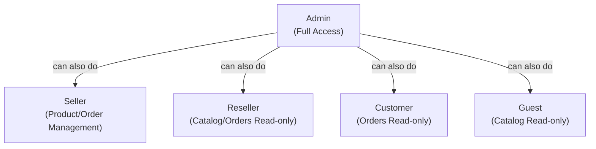
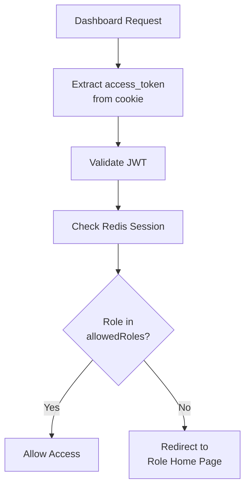
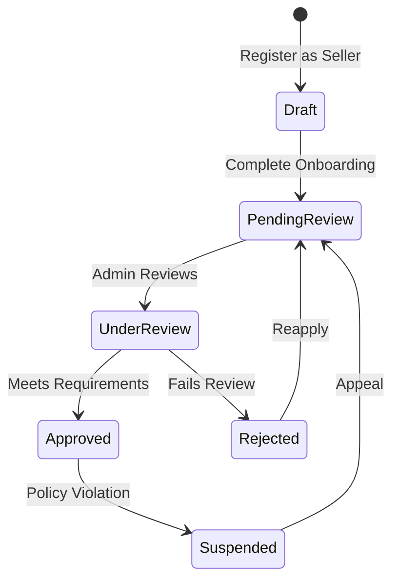

# Role-Based Access Control (RBAC)

## Executive Summary

LofiMart implements a 5-role, 9-permission RBAC system controlling access to dashboards, API endpoints, and business operations. Roles are enforced at both the middleware layer (Express routes) and the server component layer (Next.js App Router).

---

## Role Hierarchy



---

## Roles

| Role | Description | Dashboard | Access Scope |
|------|-------------|-----------|--------------|
| `guest` | Unauthenticated visitor | None | Read catalog only |
| `customer` | Registered buyer | `/account/*` | Read catalog, read own orders |
| `seller` | Multi-vendor seller | `/seller/*` | Full product/order/inventory CRUD |
| `reseller` | Affiliate reseller | `/reseller-dashboard/*` | Read catalog, read orders |
| `admin` | Platform administrator | `/admin/*` | Full access to all features |

---

## Permissions

| Permission | Description | Roles |
|-----------|-------------|-------|
| `catalog:read` | View products, categories | guest, customer, seller, reseller, admin |
| `catalog:write` | Create/edit/delete products | seller, admin |
| `orders:read` | View orders | customer, seller, reseller, admin |
| `orders:write` | Create/update/fulfill orders | seller, admin |
| `inventory:read` | View stock levels | seller, admin |
| `inventory:write` | Adjust stock | seller, admin |
| `users:read` | View user data | admin |
| `users:write` | Modify users/roles | admin |
| `admin:access` | Access admin features | admin |

---

## Permission Matrix

| Resource | guest | customer | seller | reseller | admin |
|----------|-------|----------|--------|----------|-------|
| View products | ✅ | ✅ | ✅ | ✅ | ✅ |
| Create products | ❌ | ❌ | ✅ | ❌ | ✅ |
| Edit products | ❌ | ❌ | ✅ (own) | ❌ | ✅ |
| Delete products | ❌ | ❌ | ❌ | ❌ | ✅ |
| View own orders | ❌ | ✅ | ✅ (own) | ✅ | ✅ |
| Create orders | ❌ | ✅ | ✅ | ✅ | ✅ |
| Update order status | ❌ | ❌ | ✅ (own) | ❌ | ✅ |
| View inventory | ❌ | ❌ | ✅ (own) | ❌ | ✅ |
| Adjust inventory | ❌ | ❌ | ✅ (own) | ❌ | ✅ |
| Manage users | ❌ | ❌ | ❌ | ❌ | ✅ |
| Manage sellers | ❌ | ❌ | ❌ | ❌ | ✅ |
| Access accounting | ❌ | ❌ | ❌ | ❌ | ✅ |
| Manage settings | ❌ | ❌ | ❌ | ❌ | ✅ |
| View analytics | ❌ | ❌ | ✅ (own) | ✅ (own) | ✅ |
| Manage coupons | ❌ | ❌ | ✅ (own) | ❌ | ✅ |
| Process refunds | ❌ | ❌ | ❌ | ❌ | ✅ |
| Manage flash sales | ❌ | ❌ | ✅ (submit) | ❌ | ✅ |

---

## Implementation

### RBAC Module (`src/modules/rbac/`)

```typescript
// roles.ts
export const roles = ['guest', 'customer', 'seller', 'reseller', 'admin'] as const;

// permissions.ts
export const permissions = [
  'catalog:read', 'catalog:write',
  'orders:read', 'orders:write',
  'inventory:read', 'inventory:write',
  'users:read', 'users:write',
  'admin:access'
] as const;

// authorize.ts
const rolePermissions: Record<Role, Permission[]> = {
  guest: ['catalog:read'],
  customer: ['catalog:read', 'orders:read'],
  seller: ['catalog:read', 'catalog:write', 'orders:read', 'orders:write', 'inventory:read', 'inventory:write'],
  reseller: ['catalog:read', 'orders:read'],
  admin: permissions, // all permissions
};

export function can(role: Role, permission: Permission): boolean {
  return rolePermissions[role]?.includes(permission) ?? false;
}
```

### Express Route Protection

```typescript
// src/server/auth.ts
export function createAuthenticateToken(prisma) {
  return async (req, res, next) => {
    const token = req.headers.authorization?.replace('Bearer ', '');
    const user = await validateAccessToken(token);
    if (!user) return res.status(401).json({ error: 'Unauthorized' });
    req.user = user;
    next();
  };
}

// Usage in routes
router.get('/seller/products', authenticateToken, requireRole('seller'), handler);
router.get('/admin/users', authenticateToken, requireRole('admin'), handler);
```

### Next.js Route Protection

```typescript
// src/server/next/apiSecurity.ts
export async function secureApiRoute(req, options) {
  // 1. Rate limit check
  // 2. Origin validation
  // 3. Authentication (JWT + Redis)
  // 4. Role check
  // 5. Permission check
}

// src/server/next/requireDashboardAccess.ts
export async function requireDashboardAccess(allowedRoles, currentPath) {
  // Reads access_token from cookie
  // Validates JWT + Redis session
  // Redirects unauthorized to role home page
}
```

### Dashboard Access Control



**Role Home Pages:**
| Role | Home | Redirect On Unauthorized |
|------|------|------------------------|
| customer | `/account` | `/account` |
| seller | `/seller` | `/seller` |
| reseller | `/reseller-dashboard` | `/reseller-dashboard` |
| admin | `/admin` | `/admin` |

---

## Navigation Filtering

**Implementation:** `src/lib/role-navigation.ts`

Navigation links are filtered by role using `visibleTo` properties:

```typescript
type NavigationRole = 'guest' | 'customer' | 'seller' | 'reseller' | 'admin';

function isRoleAllowed(visibleTo: NavigationRole[], role: NavigationRole): boolean {
  return visibleTo.includes(role);
}

function filterRoleAwareLinks(links, role): NavigationLink[] {
  return links.filter(link => isRoleAllowed(link.visibleTo, role));
}
```

---

## Seller Status Lifecycle



**Seller Status Values:**
- `draft` — Initial state, incomplete profile
- `pending_review` — Onboarding complete, awaiting admin review
- `under_review` — Admin actively reviewing
- `approved` — Full seller access granted
- `rejected` — Application denied
- `suspended` — Access revoked (policy violation)

---

## Tenant-Level RBAC

### TenantMembership

Users can belong to multiple tenants with different roles:

```typescript
TenantMembership {
  userId: string
  tenantId: string  // unique pair
  role: string      // tenant-specific role
  isPrimary: boolean
  invitedById: string
  acceptedAt: DateTime
}
```

### Tenant Isolation

All data queries are automatically scoped to the current tenant via Prisma middleware:
- Products, Orders, Users, Warehouses are tenant-scoped
- Platform settings, categories, banners are global

---

## Best Practices

1. **Deny by default** — Explicitly grant only required permissions
2. **Check permissions at both layers** — Middleware (Express) and server components (Next.js)
3. **Use the lowest-privilege role** — Don't give admin access when seller suffices
4. **Audit role changes** — Log all `users:write` operations
5. **Regular access reviews** — Periodically review seller/admin permissions
6. **Separate duties** — No single role should have unchecked financial access

## Known Limitations

1. **No dynamic permissions** — Roles are hardcoded, cannot be customized per tenant
2. **No permission inheritance** — Admin doesn't automatically get seller permissions via hierarchy
3. **No row-level security** — Seller can only see own data, but enforced at application level
4. **No API key scopes** — External integrations use full user permissions
5. **No audit of permission checks** — Only data mutations are audited, not access checks

## Future Improvements

1. **Dynamic permission system** — Database-driven roles and permissions
2. **Row-level security** — PostgreSQL RLS policies for tenant/seller isolation
3. **Custom role builder** — Allow tenants to define custom roles
4. **Permission audit logging** — Log all access checks, not just mutations
5. **API key scoping** — Granular permission sets for third-party integrations
6. **Time-bound permissions** — Temporary elevated access with auto-expiry
