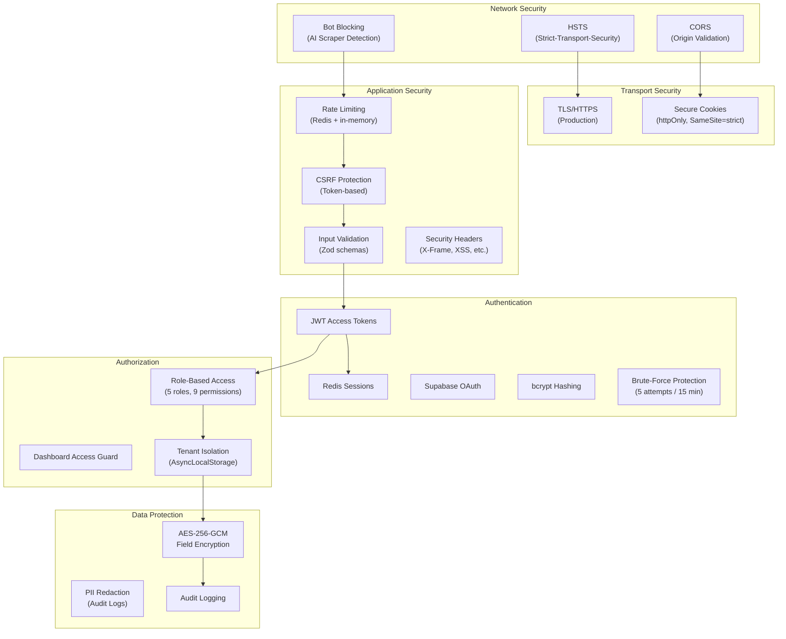
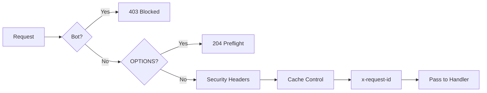
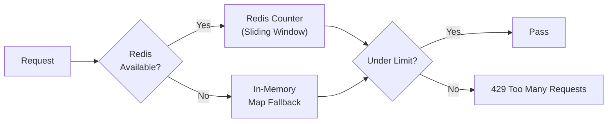

# Security Architecture

## Executive Summary

LofiMart implements a defense-in-depth security strategy covering network security, authentication, authorization, data protection, input validation, and monitoring. The system uses JWT-based sessions with Redis backing, CSRF protection, rate limiting, bot blocking, field-level encryption, and comprehensive audit logging.

---

## Security Layers



---

## Middleware Security Pipeline

### Next.js Middleware (`src/middleware.ts`)



**Bot Blocking:** Returns 403 for known AI/scraping bots on sensitive paths:
- `/api/auth`, `/api/payment`, `/api/admin`, `/api/seller`, `/api/checkout`

**Security Headers Applied:**
| Header | Value | Purpose |
|--------|-------|---------|
| `X-DNS-Prefetch-Control` | `on` | DNS prefetch |
| `X-Content-Type-Options` | `nosniff` | Prevent MIME sniffing |
| `X-Frame-Options` | `DENY` | Prevent clickjacking |
| `X-XSS-Protection` | `0` | Legacy XSS (disabled per modern best practice) |
| `Referrer-Policy` | `strict-origin-when-cross-origin` | Referrer control |
| `Strict-Transport-Security` | `max-age=31536000; includeSubDomains` | HSTS (production only) |
| `Permissions-Policy` | `camera=(), microphone=(), geolocation=()` | Feature restrictions (production only) |

---

## Rate Limiting

**Implementation:** `src/server/rateLimit.ts`



**Limits:**
| Endpoint | Limit | Window |
|----------|-------|--------|
| Auth (login/register) | 5 requests | 15 minutes |
| Password reset | 3 requests | 60 minutes |
| General API | 100 requests | 1 minute |
| Payment endpoints | 10 requests | 1 minute |

---

## CSRF Protection

**Implementation:** `src/server/security/csrf.ts`

1. Client requests CSRF token via `GET /api/auth/csrf`
2. Token stored in cookie and returned in response body
3. Client includes token in `X-CSRF-Token` header for state-changing requests
4. Server validates token against cookie value using timing-safe comparison

---

## Origin Validation

**Implementation:** `src/server/security/origin.ts`

- Maintains whitelist of allowed origins from `FRONTEND_URL` and additional origins
- Loopback addresses (localhost, 127.0.0.1) are treated as equivalent
- All API requests from non-browser clients must pass origin check
- Referer header validated as fallback

---

## Authentication Security

### Password Hashing
- **Algorithm:** bcrypt (via Supabase Auth)
- **Salt rounds:** 12 (Supabase default)

### JWT Configuration
- **Algorithm:** HS256
- **Access Token TTL:** 24h (customers), 1h (seller/reseller/admin)
- **Refresh Token:** Stored in Redis, sliding expiration
- **Claims:** `{ id, role, email, tenantId, sid }`

### Brute-Force Protection
- 5 failed login attempts triggers 15-minute account lockout
- Lockout tracked per email in Redis
- Rate limit applied per IP as additional layer

### Session Management
- Sessions stored in Redis with device info (name, IP, user agent, location)
- Session rotation on refresh (sliding expiration)
- Revocation supported per-session or all-sessions
- Concurrent session limits enforced per role

---

## Data Protection

### Field-Level Encryption

**Implementation:** `src/features/shared/services/security/fieldEncryption.ts`

- **Algorithm:** AES-256-GCM (authenticated encryption)
- **Key derivation:** SHA-256 hash of `JWT_SECRET + ":profile-encryption"`
- **IV:** 12-byte random IV per encryption
- **Used for:** Payout method account numbers, routing numbers, mobile numbers

```typescript
// Encrypt
const encrypted = encryptSensitiveValue("01700000000");
// Returns: base64({ iv, tag, value }) → base64 encoded

// Decrypt
const plain = decryptSensitiveValue(encrypted);

// Redact (for display)
const masked = redactSensitiveValue(encrypted); // "****0000"
```

### Cookie Security

```
httpOnly: true
secure: true (production)
sameSite: strict
path: /
maxAge: role-based (24h customer, 1h seller/admin)
```

---

## Security Headers (Express)

Applied via `src/server/middleware/corsProtection.ts`:
- `X-Request-ID` — Unique request identifier
- `X-Content-Type-Options: nosniff`
- `X-Frame-Options: DENY`
- `X-XSS-Protection: 0`
- `Referrer-Policy: strict-origin-when-cross-origin`
- `Permissions-Policy: camera=(), microphone=(), geolocation=()`

---

## Audit Logging

**Model:** `AuditLog`

| Field | Purpose |
|-------|---------|
| `userId` | Actor performing the action |
| `action` | Action type (e.g., `order.created`, `user.role_changed`) |
| `entityType` | Entity type (e.g., `Order`, `User`) |
| `entityId` | Specific entity affected |
| `metadata` | JSON payload with action details |

**Logged Events:**
- User registration, login, logout
- Order creation, status changes, cancellations
- Payment transactions, refunds
- Product CRUD operations
- Admin user management actions
- Seller approval/rejection
- Role changes, account deletions

---

## Risk Assessment

**Models:** `VerificationSubmission`, `UserRiskFlag`

| Feature | Purpose |
|---------|---------|
| `VerificationSubmission` | Seller identity verification with document uploads, risk scoring |
| `UserRiskFlag` | Admin-flagged risk indicators (severity levels) |
| `AccountActionRequest` | Cancellation/refund requests with resolution tracking |

---

## Security Risks & Recommendations

| Risk | Severity | Recommendation |
|------|----------|----------------|
| WebSocket has no authentication | High | Add JWT token validation on WS connection |
| Single JWT secret for all purposes | Medium | Use separate secrets for JWT, encryption, CSRF |
| No API key authentication for external integrations | Medium | Implement API key management for partner access |
| In-memory rate limit fallback not shared | Medium | Always require Redis in production |
| Bot blocking based on User-Agent only | Low | Add behavioral analysis for bot detection |
| No Content Security Policy headers | Low | Implement CSP with nonce-based script loading |
| No request size limits beyond body parser | Low | Add explicit request body size limits |

---

## Best Practices

1. **Never store secrets in code** — Use environment variables
2. **Validate all input** — Zod schemas on every endpoint
3. **Use parameterized queries** — Prisma handles this automatically
4. **Rotate JWT secrets** regularly — At least quarterly
5. **Monitor failed auth attempts** — Alert on unusual patterns
6. **Encrypt PII at rest** — Field-level encryption for sensitive data
7. **Use timing-safe comparisons** — For all token/secret validations
8. **Apply principle of least privilege** — RBAC with minimal permissions per role
9. **Log security events** — Comprehensive audit trail
10. **Keep dependencies updated** — Regular `npm audit` checks

## Known Limitations

1. No Web Application Firewall (WAF) integration
2. No DDoS protection beyond rate limiting
3. No IP-based geo-blocking
4. No Content Security Policy (CSP) headers
5. No certificate pinning for mobile clients
6. CSRF tokens not rotated per-session

## Future Improvements

1. Add WAF (Cloudflare/AWS WAF) integration
2. Implement CSP headers with nonce-based script loading
3. Add API key authentication for third-party integrations
4. Implement request signing for webhook verification
5. Add anomaly detection for fraud prevention
6. Implement data retention policies with automated cleanup
