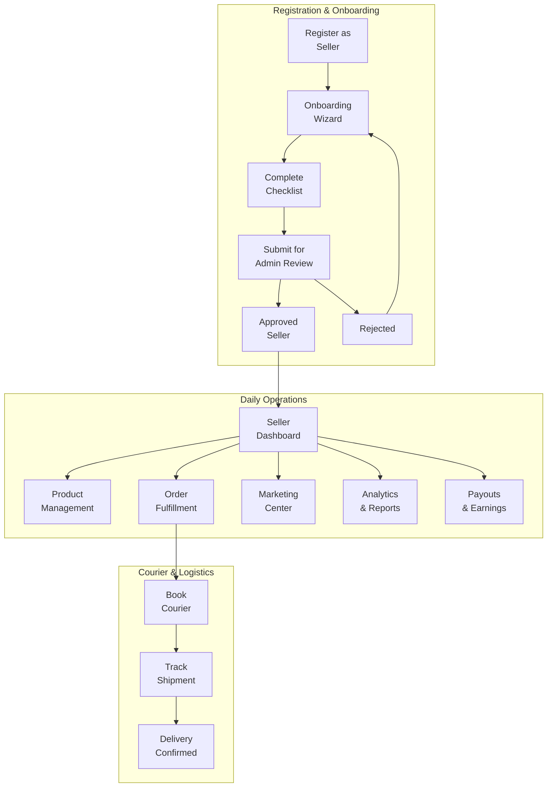
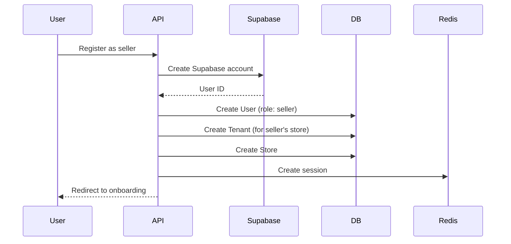
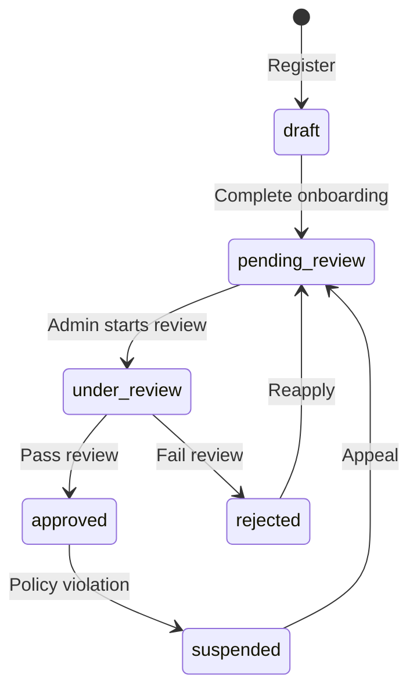
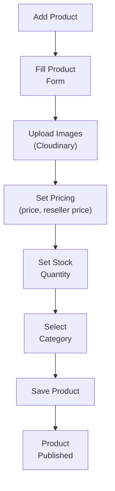
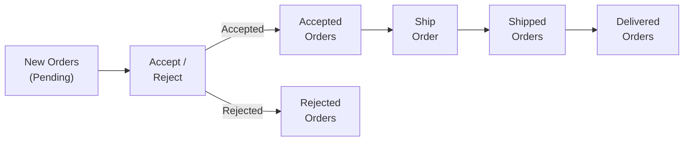
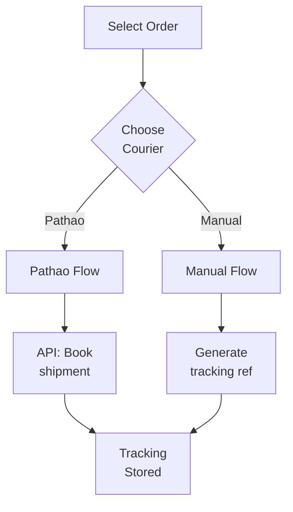
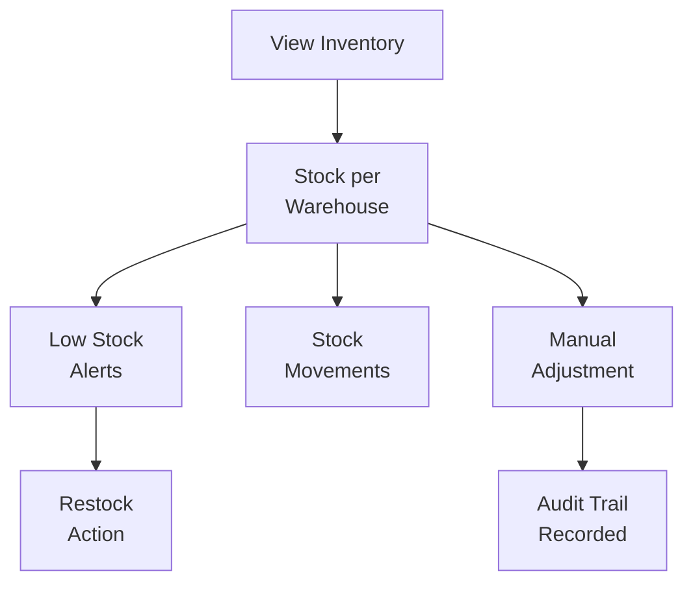
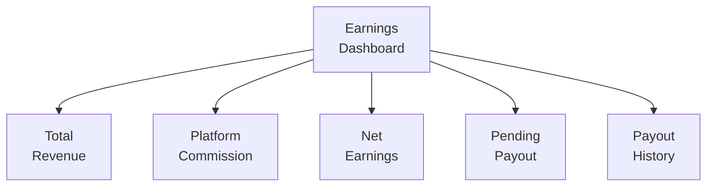
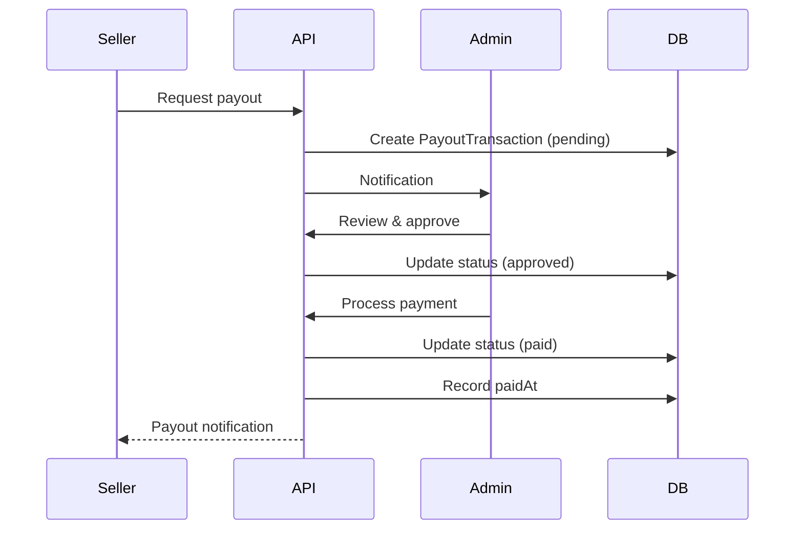
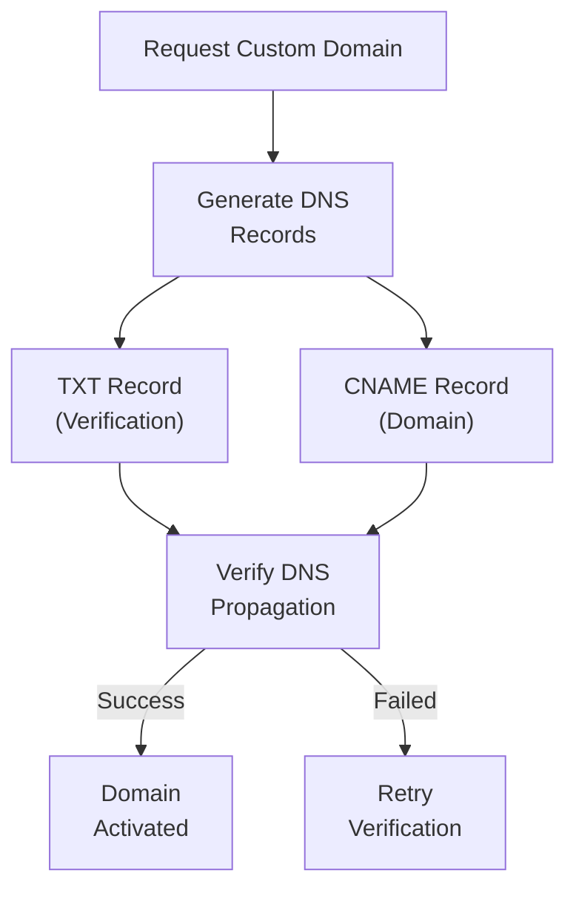

# Seller Flow

## Executive Summary

LofiMart's seller flow covers the complete seller lifecycle from registration through onboarding, product management, order fulfillment, courier integration, marketing, earnings tracking, and payout processing. Sellers operate through a dedicated dashboard with AI-powered insights and Telegram bot integration.

---

## Seller Lifecycle



---

## Seller Registration



**Registration Fields:**
- Name, Email, Password
- Store Name
- Phone Number
- Role: "seller"

---

## Onboarding Wizard

### Checklist Items

| Step | Description | Required |
|------|-------------|----------|
| 1 | Store name & description | ✅ |
| 2 | Business information | ✅ |
| 3 | Pickup location/warehouse | ✅ |
| 4 | Product listings | ✅ (min 1) |
| 5 | Storefront branding | ❌ |

### Onboarding Status Tracking

```typescript
OnboardingStatus {
  progress_percent: number      // 0-100
  completed_steps: number
  total_steps: number
  ready_for_admin_review: boolean
  next_step: {
    title: string
    action_path: string
  }
}
```

### Seller Status Progression



---

## Product Management

### Adding Products



### Product Fields

| Field | Required | Description |
|-------|----------|-------------|
| Name | ✅ | Product title |
| SKU | ✅ | Unique identifier |
| Price | ✅ | Selling price (BDT) |
| Old Price | ❌ | Original/strikethrough price |
| Stock | ✅ | Available quantity |
| Category | ✅ | Product category |
| Description | ✅ | Product description |
| Reseller Enabled | ❌ | Allow resellers to sell |
| Reseller Base Price | ❌ | Minimum reseller price |

### Bulk Upload

Supports CSV import for multiple products:
- Template download
- CSV validation
- Batch creation with error reporting

---

## Order Fulfillment

### Seller Order View



### Courier Management



### Courier Provider Capabilities

| Provider | API Mode | Auto Book | COD | Tracking Sync |
|----------|----------|-----------|-----|---------------|
| Pathao | API/Manual | ✅ (requires a pre-mapped Pathao store) | ✅ | ✅ |

### Telegram Bot Integration

Sellers can manage orders directly from Telegram:

```
Notifications:
- New order alert with order details
- Accept/Reject buttons
- Invoice delivery on acceptance

Order Management:
- Mark as shipped
- Mark as delivered
- Low stock alerts
```

---

## Inventory Management

### Stock Overview



### Inventory Rules
- Stock tracked per warehouse
- Movements logged: `sale`, `return`, `adjustment`, `restock`
- Low stock alerts via Telegram
- Reserved stock shown separately

---

## Marketing Center

### Features

| Feature | Description |
|---------|-------------|
| Coupons | Create percentage/flat discount codes |
| Promotions | Promotion campaigns |
| Ads | Advertising management |
| Flash Sales | Submit products for flash sale participation |

### Coupon Creation

```typescript
CouponInput {
  code: string           // Unique, e.g., "SELLER10"
  discountType: 'percent' | 'flat'
  discountValue: number  // e.g., 10 (for 10% or 10 BDT)
  minOrderValue: number  // Minimum cart value
  expiryDate: DateTime   // When coupon expires
}
```

---

## Earnings & Payouts

### Earnings Dashboard



### Payout Flow



### Payout Method Security

- Account numbers encrypted with AES-256-GCM
- Only last 4 digits shown in UI
- Multiple payout methods supported
- One default method per seller

---

## Storefront Settings

Sellers can customize their public storefront:

| Setting | Description |
|---------|-------------|
| Store name | Display name |
| Store description | About the store |
| Banner image | Storefront banner (Cloudinary) |
| Custom domain | CNAME/TXT DNS verification |
| Social links | Facebook, Instagram, etc. |

### Custom Domain Verification



---

## AI-Powered Dashboard Intelligence

The seller dashboard includes AI-generated insights:

### Health Signals
- **Publish Readiness:** Onboarding completion percentage
- **Inventory Risk:** Low stock items count
- **Courier Load:** Active vs delivered shipments

### Focus Action
Dynamic recommendation based on current state:
- Critical: Restock urgent SKUs
- Warning: Clear fulfillment backlog
- Info: Complete store setup
- Success: Ready for growth

### AI Insights
- Low stock warnings
- Onboarding completion prompts
- Sales trend analysis
- Top product recommendations
- Shipment backlog alerts

---

## Seller Settings

| Setting | Description |
|---------|-------------|
| Profile | Name, email, phone |
| Store | Store name, description, branding |
| Notifications | Order alerts, marketing, security |
| Vacation Mode | Temporary store pause |
| Password | Change password |

### Vacation Mode
- Temporarily pause store
- Products hidden from search
- Existing orders still fulfilled
- Auto-reactivate on end date

---

## Best Practices

1. **Complete onboarding early** — Full setup builds customer trust
2. **Maintain stock levels** — Prevent overselling with reorder alerts
3. **Respond quickly** — Fast order acceptance improves seller rating
4. **Use Telegram integration** — Get instant order notifications
5. **Track earnings regularly** — Monitor commission deductions

## Known Limitations

1. No real-time stock sync with external platforms
2. No automated repricing based on competition
3. No multi-warehouse shipping optimization
4. No A/B testing for storefronts
5. No automated email marketing integration

## Future Improvements

1. Automated inventory sync across platforms
2. AI-powered pricing recommendations
3. Multi-warehouse shipping optimization
4. Storefront A/B testing
5. Email/SMS marketing integration
6. Seller performance scoring
7. Automated repricing engine
